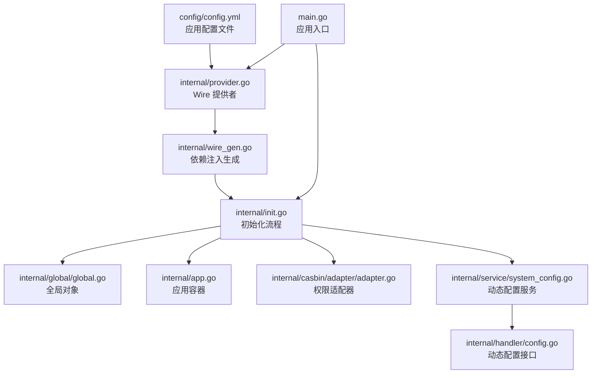
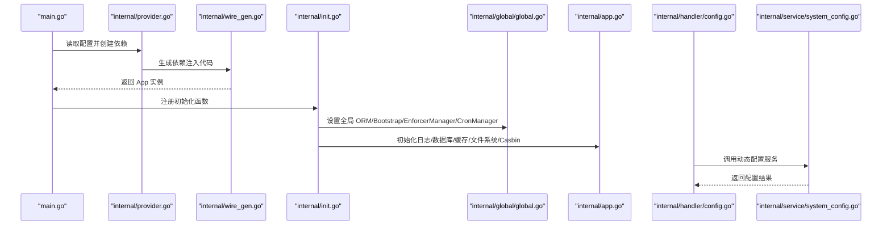
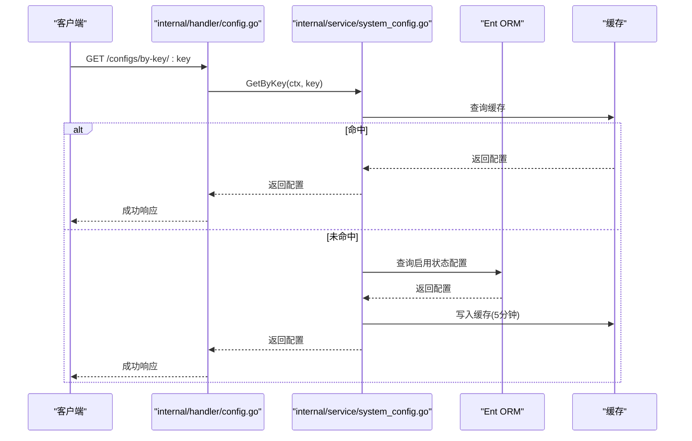
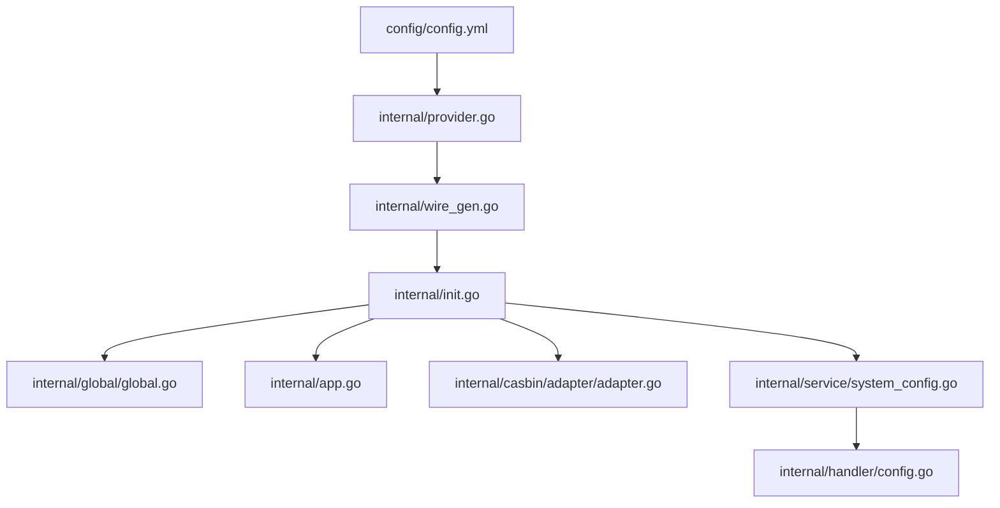

# 配置管理

<cite>
**本文引用的文件**
- [config.yml](file://config/config.yml)
- [main.go](file://main.go)
- [init.go](file://internal/init.go)
- [provider.go](file://internal/provider.go)
- [wire_gen.go](file://internal/wire_gen.go)
- [global.go](file://internal/global/global.go)
- [app.go](file://internal/app.go)
- [config.go](file://internal/handler/config.go)
- [system_config.go](file://internal/service/system_config.go)
- [adapter.go](file://internal/casbin/adapter/adapter.go)
</cite>

## 目录
1. [简介](#简介)
2. [项目结构](#项目结构)
3. [核心组件](#核心组件)
4. [架构总览](#架构总览)
5. [详细组件分析](#详细组件分析)
6. [依赖分析](#依赖分析)
7. [性能考虑](#性能考虑)
8. [故障排查指南](#故障排查指南)
9. [结论](#结论)
10. [附录](#附录)

## 简介
本文件面向 Go Admin 管理系统的配置管理，围绕 config.yml 配置文件展开，系统性说明应用配置、数据库配置、缓存配置、文件系统配置、Casbin 权限配置等模块的结构与作用；解释环境变量的使用与配置优先级；给出运行时配置更新机制与限制；并提供安全配置建议、性能调优参数、生产环境最佳实践、版本管理与迁移方法、以及多环境配置与模板使用指南。

## 项目结构
Go Admin 的配置体系由以下关键部分组成：
- 配置文件：config/config.yml
- 启动与初始化：main.go、internal/init.go
- 依赖注入与提供者：internal/provider.go、internal/wire_gen.go
- 全局共享对象：internal/global/global.go
- 应用容器：internal/app.go
- 运行时动态配置：internal/handler/config.go、internal/service/system_config.go
- 权限适配器：internal/casbin/adapter/adapter.go

**图表来源**
- [config.yml](file://config/config.yml)
- [provider.go](file://internal/provider.go)
- [wire_gen.go](file://internal/wire_gen.go)
- [init.go](file://internal/init.go)
- [global.go](file://internal/global/global.go)
- [app.go](file://internal/app.go)
- [adapter.go](file://internal/casbin/adapter/adapter.go)
- [system_config.go](file://internal/service/system_config.go)
- [config.go](file://internal/handler/config.go)
- [main.go](file://main.go)

**章节来源**
- [config.yml](file://config/config.yml)
- [main.go](file://main.go)
- [init.go](file://internal/init.go)
- [provider.go](file://internal/provider.go)
- [wire_gen.go](file://internal/wire_gen.go)
- [global.go](file://internal/global/global.go)
- [app.go](file://internal/app.go)
- [adapter.go](file://internal/casbin/adapter/adapter.go)
- [system_config.go](file://internal/service/system_config.go)
- [config.go](file://internal/handler/config.go)

## 核心组件
- 应用配置（app）
  - 名称、端口、调试模式、空闲超时、预取进程、Swagger 开关、密钥、登录过期时间等。
- 日志配置（log）
  - 文件路径、控制台输出、文件输出、最大尺寸、备份数、保留天数。
- 数据库配置（database）
  - 默认连接名、连接列表（驱动、主机、端口、用户名、密码、数据库名、SSL、表前缀）。
- 缓存配置（cache）
  - 默认缓存存储、内存与 Redis 存储定义及默认 TTL。
- Redis 连接配置（redis）
  - 连接池大小、空闲连接数、超时、TLS 等。
- 文件系统配置（filesystem）
  - 默认磁盘、是否与本地结合、本地与 S3 驱动及对应选项。
- Casbin 权限配置（casbin）
  - 默认域、域列表（名称、自动加载、模型文本）、模型说明与示例。

**章节来源**
- [config.yml](file://config/config.yml)

## 架构总览
配置从 config.yml 加载，经由 Wire 注入到应用容器，初始化数据库、缓存、文件系统、Casbin 权限等子系统，并在运行时通过动态配置接口对系统配置进行增删改查与缓存管理。

**图表来源**
- [main.go](file://main.go)
- [provider.go](file://internal/provider.go)
- [wire_gen.go](file://internal/wire_gen.go)
- [init.go](file://internal/init.go)
- [global.go](file://internal/global/global.go)
- [app.go](file://internal/app.go)
- [config.go](file://internal/handler/config.go)
- [system_config.go](file://internal/service/system_config.go)

## 详细组件分析

### 应用配置（app）
- 作用：定义应用运行的基本参数，如监听端口、调试模式、Swagger 开关、密钥与登录过期时间等。
- 关键点：
  - 端口与预取进程：影响并发与部署形态。
  - 调试模式：影响日志级别与错误展示。
  - 登录过期：与鉴权流程配合，决定会话生命周期。
  - Secret：用于签发令牌等场景的安全密钥。

**章节来源**
- [config.yml](file://config/config.yml)

### 日志配置（log）
- 作用：统一管理日志输出目标与滚动策略。
- 关键点：
  - 控制台与文件双输出：便于开发与生产环境观测。
  - 文件滚动：通过最大尺寸、备份数、保留天数控制磁盘占用。

**章节来源**
- [config.yml](file://config/config.yml)

### 数据库配置（database）
- 作用：定义默认连接与连接池参数，支持多连接切换。
- 关键点：
  - 表前缀：用于多租户或多实例隔离。
  - SSL：生产环境建议开启。
  - 连接 DNS：由驱动与连接参数拼装。

**章节来源**
- [config.yml](file://config/config.yml)
- [provider.go](file://internal/provider.go)
- [init.go](file://internal/init.go)

### 缓存配置（cache）
- 作用：定义默认缓存存储类型与各存储的默认 TTL。
- 关键点：
  - 内存缓存：适合单实例或测试。
  - Redis 缓存：适合分布式与高可用场景。

**章节来源**
- [config.yml](file://config/config.yml)

### Redis 连接配置（redis）
- 作用：连接 Redis 服务器，配置连接池与超时参数。
- 关键点：
  - 连接池大小与空闲连接数：平衡吞吐与资源。
  - 超时与 TLS：保障网络稳定性与安全性。

**章节来源**
- [config.yml](file://config/config.yml)

### 文件系统配置（filesystem）
- 作用：定义默认磁盘与驱动（本地/云存储），支持本地根目录与 S3 参数。
- 关键点：
  - 本地驱动：root 指向存储目录。
  - S3 驱动：需正确配置密钥、区域、桶与端点。

**章节来源**
- [config.yml](file://config/config.yml)

### Casbin 权限配置（casbin）
- 作用：定义默认域与多域权限模型，支持自动加载与内联模型文本。
- 关键点：
  - 默认域与模型文本：快速启用带域的 RBAC。
  - 多域：为不同租户或业务域提供独立策略。
  - 自动加载：高频访问域建议开启以减少延迟。

**章节来源**
- [config.yml](file://config/config.yml)
- [adapter.go](file://internal/casbin/adapter/adapter.go)
- [init.go](file://internal/init.go)

### 运行时配置更新（动态配置）
- 作用：通过接口对系统配置进行增删改查，并提供缓存与校验。
- 关键点：
  - 接口：创建、列表、详情、按键查询、按组查询、更新、删除。
  - 缓存：按键查询与按组查询具备缓存，更新/删除后清理缓存。
  - 校验：字段长度、类型、状态等校验规则。
  - 限制：键唯一性约束，避免重复；仅启用状态参与查询。

**图表来源**
- [config.go](file://internal/handler/config.go)
- [system_config.go](file://internal/service/system_config.go)

**章节来源**
- [config.go](file://internal/handler/config.go)
- [system_config.go](file://internal/service/system_config.go)

## 依赖分析
- 配置加载链路
  - config.yml → Wire 提供者 → 初始化流程 → 全局对象 → 应用容器 → 各子系统。
- 关键依赖
  - 数据库：由 provider 与 init 组合创建 ORM 客户端并执行迁移。
  - Casbin：由 adapter 与 init 组合创建适配器并初始化 EnforcerManager。
  - 动态配置：由 handler 与 service 组合提供 REST 接口与缓存逻辑。

**图表来源**
- [config.yml](file://config/config.yml)
- [provider.go](file://internal/provider.go)
- [wire_gen.go](file://internal/wire_gen.go)
- [init.go](file://internal/init.go)
- [global.go](file://internal/global/global.go)
- [app.go](file://internal/app.go)
- [adapter.go](file://internal/casbin/adapter/adapter.go)
- [system_config.go](file://internal/service/system_config.go)
- [config.go](file://internal/handler/config.go)

**章节来源**
- [provider.go](file://internal/provider.go)
- [wire_gen.go](file://internal/wire_gen.go)
- [init.go](file://internal/init.go)
- [global.go](file://internal/global/global.go)
- [app.go](file://internal/app.go)
- [adapter.go](file://internal/casbin/adapter/adapter.go)
- [system_config.go](file://internal/service/system_config.go)
- [config.go](file://internal/handler/config.go)

## 性能考虑
- 数据库
  - 合理设置表前缀，避免跨实例冲突；生产环境开启 SSL；根据负载调整连接池大小与超时。
- 缓存
  - Redis 作为默认缓存时，注意连接池大小与空闲连接数匹配实际 QPS；为高频查询配置合理 TTL。
- 文件系统
  - S3 驱动建议开启 TLS 并优化网络超时；本地驱动注意磁盘 IO 与容量监控。
- Casbin
  - 对高频访问域开启自动加载；模型文本尽量简洁；批量写入策略时采用事务与批量插入。
- 动态配置
  - 按键查询与按组查询具备缓存，建议合理设置缓存 TTL；更新/删除后及时清理缓存。

[本节为通用建议，无需特定文件引用]

## 故障排查指南
- 配置键冲突
  - 现象：创建/更新配置时报错“配置键已存在”。
  - 处理：检查键是否重复，必要时先删除再创建或修改键。
- 配置不存在
  - 现象：按键查询或按 ID 查询返回“配置不存在”。
  - 处理：确认键或 ID 正确；检查状态是否为启用。
- 数据库连接失败
  - 现象：启动时报数据库连接错误。
  - 处理：核对主机、端口、用户名、密码、数据库名与 SSL 设置；确认网络连通。
- Casbin 策略未生效
  - 现象：权限变更后仍沿用旧策略。
  - 处理：若使用自动加载，确认域已开启自动加载；否则手动触发策略重载。
- 动态配置缓存异常
  - 现象：更新配置后读取到旧值。
  - 处理：确认缓存清理逻辑已执行；检查缓存键命名与 TTL。

**章节来源**
- [system_config.go](file://internal/service/system_config.go)
- [config.go](file://internal/handler/config.go)
- [init.go](file://internal/init.go)

## 结论
Go Admin 的配置体系以 config.yml 为核心，结合 Wire 依赖注入与初始化流程，将应用、数据库、缓存、文件系统与 Casbin 权限有机整合。运行时动态配置提供了灵活的系统参数管理能力，并通过缓存与校验保障性能与一致性。遵循本文的安全与性能建议、版本管理与迁移方法，可在多环境中稳定部署与演进。

[本节为总结，无需特定文件引用]

## 附录

### 环境变量与配置优先级
- 说明：仓库中未发现显式的环境变量覆盖逻辑。通常建议在容器化部署时通过环境变量注入敏感配置（如数据库密码、Redis 密钥、Secret），并在启动前进行合并或覆盖。
- 建议：
  - 使用环境变量管理敏感字段；
  - 在启动脚本或编排系统中实现“环境变量优先”的覆盖策略；
  - 对外暴露的配置文件仅保留非敏感参数。

[本节为通用建议，无需特定文件引用]

### 运行时配置更新机制与限制
- 机制
  - 通过 REST 接口进行创建、查询、更新、删除；
  - 按键查询与按组查询具备缓存；
  - 更新/删除后清理缓存。
- 限制
  - 键必须唯一；
  - 仅启用状态的配置参与按键/按组查询；
  - 字段长度与类型受校验约束。

**章节来源**
- [config.go](file://internal/handler/config.go)
- [system_config.go](file://internal/service/system_config.go)

### 安全配置建议
- 应用层
  - 生产环境关闭调试模式；
  - 使用强随机密钥并定期轮换；
  - 启用登录过期与会话管理。
- 数据库
  - 生产环境开启 SSL；
  - 使用专用账号与最小权限原则；
  - 定期备份与审计。
- 缓存与文件系统
  - Redis 开启 TLS 与认证；
  - S3 驱动使用 IAM 角色或短期凭证；
  - 本地存储限制访问权限与磁盘空间。
- Casbin
  - 模型文本最小化；
  - 高频域自动加载；
  - 策略变更后及时重载。

**章节来源**
- [config.yml](file://config/config.yml)
- [system_config.go](file://internal/service/system_config.go)

### 性能调优参数
- 数据库
  - 连接池大小与最大生命周期；
  - 表前缀与索引设计。
- 缓存
  - Redis 连接池与空闲连接数；
  - 缓存 TTL 与批量写入策略。
- 文件系统
  - S3 超时与并发；
  - 本地磁盘 IO 与目录结构。
- Casbin
  - 自动加载与批量策略；
  - 事务与批量插入。
- 动态配置
  - 缓存命中率与 TTL；
  - 查询过滤与分页。

**章节来源**
- [config.yml](file://config/config.yml)
- [system_config.go](file://internal/service/system_config.go)

### 生产环境最佳实践
- 配置管理
  - 使用版本控制管理 config.yml；
  - 通过环境分支与模板生成不同环境配置；
  - 敏感信息通过环境变量注入。
- 部署与运维
  - 容器化部署，统一镜像与编排；
  - 健康检查与日志采集；
  - 自动化发布与回滚策略。
- 监控与告警
  - 关键指标（QPS、错误率、延迟、缓存命中率、数据库连接数）；
  - 异常告警与日志聚合。

**章节来源**
- [config.yml](file://config/config.yml)
- [main.go](file://main.go)

### 版本管理与迁移
- 配置版本管理
  - 使用 Git 管理 config.yml，按环境分支维护；
  - 通过模板与变量生成最终配置，避免手改。
- 数据库迁移
  - 初始化阶段自动执行迁移；
  - 生产变更前先在测试环境验证。
- Casbin 策略迁移
  - 通过适配器批量导入导出；
  - 多域策略按域分别迁移与验证。

**章节来源**
- [provider.go](file://internal/provider.go)
- [adapter.go](file://internal/casbin/adapter/adapter.go)

### 多环境配置与模板使用
- 环境划分
  - 开发、测试、预发布、生产四环境；
  - 每环境独立的 config.yml 与环境变量。
- 模板与变量
  - 使用模板引擎渲染配置；
  - 通过变量映射不同环境参数；
  - 生成最终配置后进行静态检查与审批。

**章节来源**
- [config.yml](file://config/config.yml)
- [main.go](file://main.go)