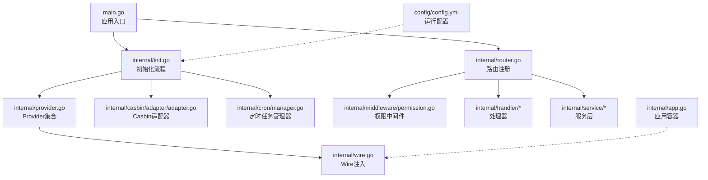
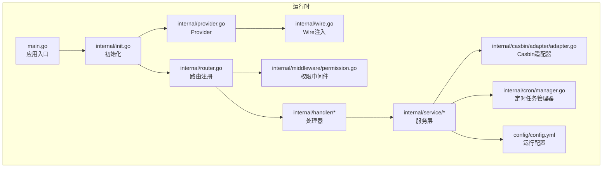
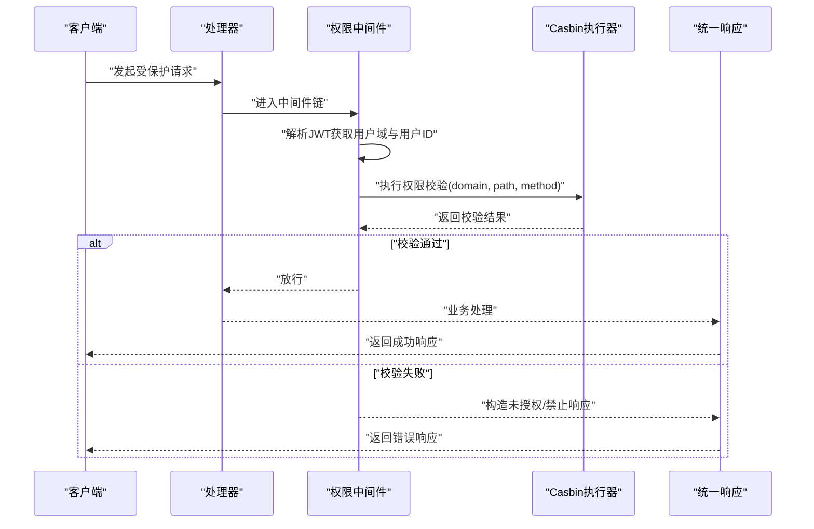
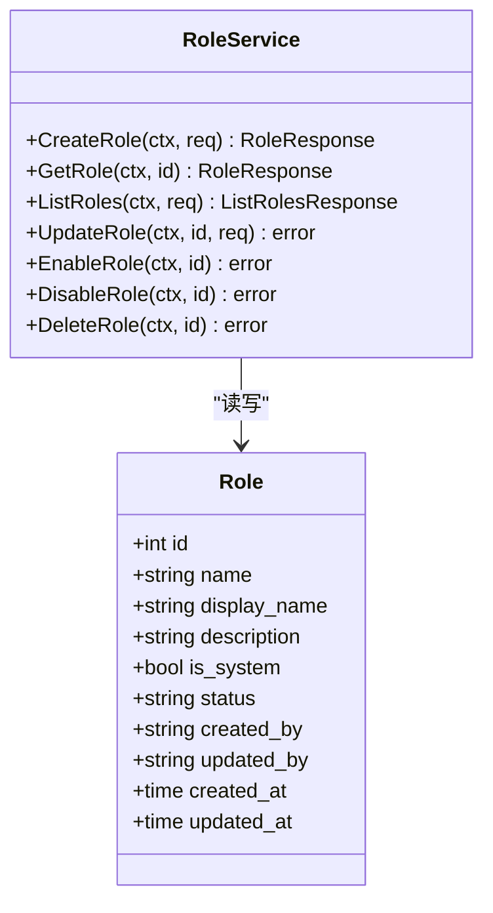
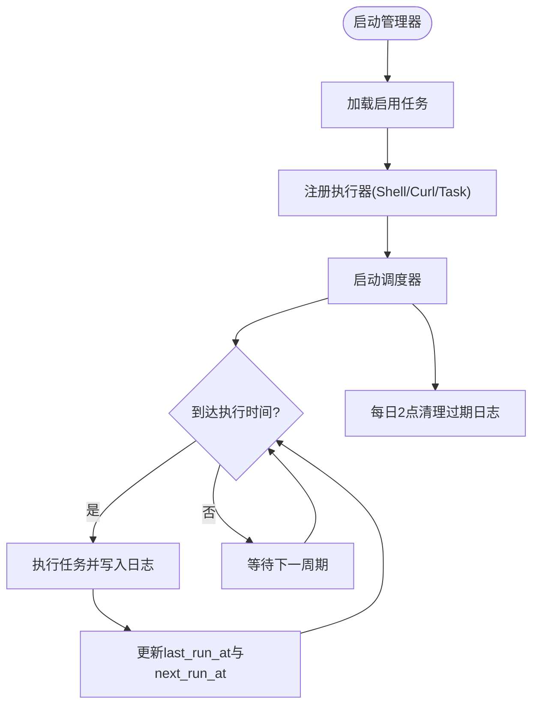
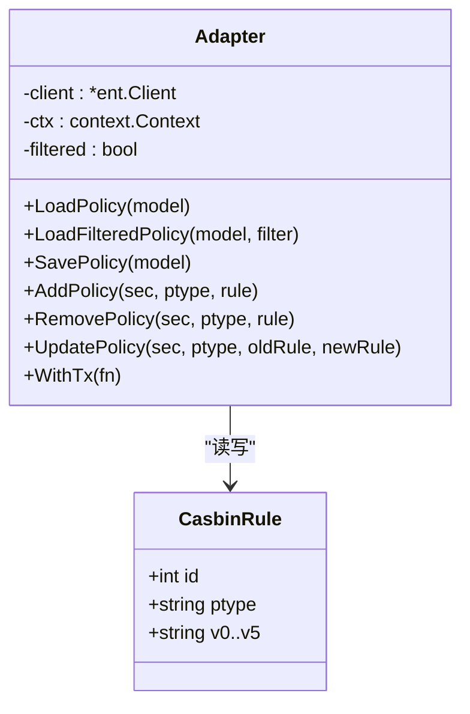
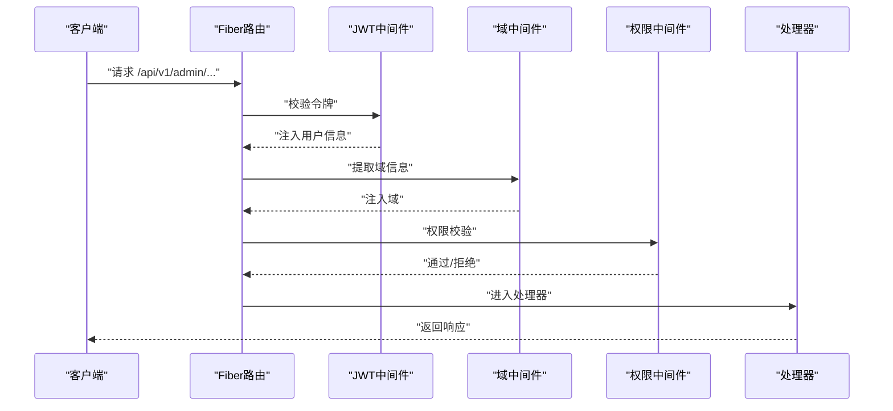
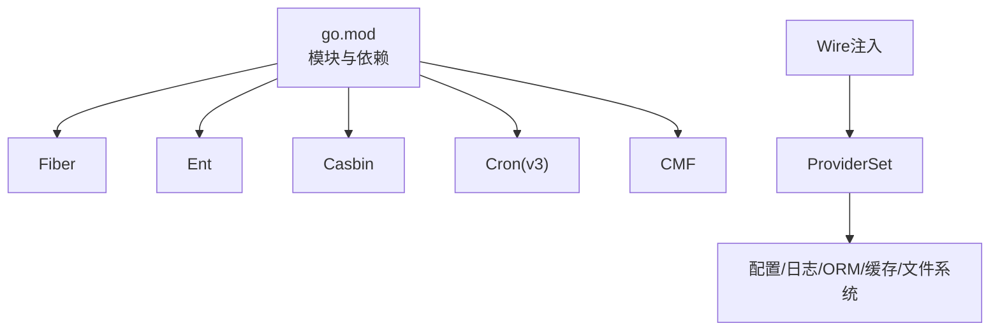

# 项目概述

<cite>
**本文引用的文件**
- [main.go](file://main.go)
- [app.go](file://internal/app.go)
- [config.yml](file://config/config.yml)
- [router.go](file://internal/router.go)
- [init.go](file://internal/init.go)
- [provider.go](file://internal/provider.go)
- [wire.go](file://internal/wire.go)
- [adapter.go](file://internal/casbin/adapter/adapter.go)
- [manager.go](file://internal/cron/manager.go)
- [permission.go](file://internal/service/permission.go)
- [role.go](file://internal/service/role.go)
- [permission.go](file://internal/middleware/permission.go)
- [public.go](file://internal/handler/public.go)
- [role.go](file://internal/ent/schema/role.go)
- [go.mod](file://go.mod)
</cite>

## 目录
1. [简介](#简介)
2. [项目结构](#项目结构)
3. [核心组件](#核心组件)
4. [架构总览](#架构总览)
5. [详细组件分析](#详细组件分析)
6. [依赖分析](#依赖分析)
7. [性能考量](#性能考量)
8. [故障排查指南](#故障排查指南)
9. [结论](#结论)
10. [附录](#附录)

## 简介
Go Admin 是一个基于 Go 语言构建的企业级后台管理系统，专注于提供完善的权限控制、定时任务调度与文件存储管理能力。系统采用模块化设计，结合 Fiber Web 框架、Ent ORM、Casbin 权限引擎、Robfig Cron 调度器与 CMF 基础设施库，形成高内聚、低耦合的现代化后台解决方案。

- 目标与定位
  - 快速搭建企业后台管理平台，支持多租户/多域权限模型，满足复杂权限场景。
  - 提供统一的定时任务编排与执行能力，覆盖 Shell、Curl、自定义任务三类执行器。
  - 支持本地与 S3 等多种文件存储后端，满足不同部署环境需求。
  - 通过 Swagger 文档与响应封装，降低前后端协作成本。

- 核心功能概览
  - 权限控制：RBAC 多域模型、角色/权限管理、动态权限校验。
  - 定时任务：周期性任务调度、立即执行、日志轮转与保留策略。
  - 文件存储：附件上传、分组管理、预览与移动、多盘支持。
  - 用户中心：登录、刷新令牌、个人信息维护、密码修改。
  - 运维可观测：操作日志记录、请求日志中间件、统一响应封装。

- 技术优势
  - 依赖注入与 Provider：通过 Wire 实现应用依赖的集中管理与可测试性。
  - 数据一致性：Casbin 适配器基于事务批量写入，保证策略持久化一致性。
  - 性能优化：权限查询与用户权限缓存，显著降低鉴权延迟。
  - 可扩展性：模块化路由与中间件，便于按需扩展新功能。

- 差异化特点
  - 多域 Casbin 模型：支持为不同租户或业务域配置独立模型，满足强隔离场景。
  - 统一响应与日志：内置响应封装与请求日志中间件，统一错误码与日志格式。
  - 前后端一体化：嵌入式静态资源与 SPA 路由回退，简化部署。

## 项目结构
项目采用“按功能域+层次化”的组织方式，核心目录如下：
- cmd/seed：种子数据入口（如需）。
- config：运行配置（应用、日志、数据库、缓存、Redis、文件系统、Casbin 多域模型等）。
- data：运行时数据（日志、存储根目录）。
- docs：Swagger 文档资源。
- internal：核心业务代码
  - app.go：应用依赖容器定义。
  - init.go：应用初始化流程（数据库、Casbin、定时任务）。
  - provider.go：Wire Provider 集合（ORM、Casbin、文件系统等）。
  - wire.go：Wire 依赖注入入口。
  - router.go：路由注册与中间件装配。
  - middleware：权限中间件、域中间件。
  - handler：HTTP 处理器（登录、用户、角色、权限、定时任务、附件、操作日志等）。
  - service：业务服务层（权限、角色、定时任务、附件、操作日志等）。
  - ent：Ent 自动生成的实体与查询代码。
  - cron：定时任务管理器与执行器。
  - casbin/adapter：Casbin 适配器（策略持久化与事务批量写入）。
  - utils：工具函数与统一响应封装。
  - global：全局对象（ORM、EnforcerManager、CronManager 等）。
- go.mod：模块与依赖声明。

**图示来源**
- [main.go:47-104](file://main.go#L47-L104)
- [init.go:31-67](file://internal/init.go#L31-L67)
- [router.go:16-150](file://internal/router.go#L16-L150)
- [provider.go:17-44](file://internal/provider.go#L17-L44)
- [wire.go:22-37](file://internal/wire.go#L22-L37)
- [adapter.go:97-113](file://internal/casbin/adapter/adapter.go#L97-L113)
- [manager.go:26-38](file://internal/cron/manager.go#L26-L38)
- [permission.go:14-94](file://internal/middleware/permission.go#L14-L94)
- [app.go:15-26](file://internal/app.go#L15-L26)

**章节来源**
- [main.go:47-104](file://main.go#L47-L104)
- [router.go:16-150](file://internal/router.go#L16-L150)
- [init.go:31-67](file://internal/init.go#L31-L67)
- [provider.go:17-44](file://internal/provider.go#L17-L44)
- [wire.go:22-37](file://internal/wire.go#L22-L37)
- [app.go:15-26](file://internal/app.go#L15-L26)

## 核心组件
- 应用容器与依赖注入
  - App 容器聚合配置、日志、数据库、验证器、缓存、Ent 客户端、Casbin 执行器、文件系统等。
  - 通过 Wire Provider 与注入入口集中管理依赖，支持可替换的存储与缓存实现。
- 权限控制（RBAC）
  - Casbin 适配器基于 Ent 持久化策略，支持多域模型与过滤加载。
  - 中间件从 JWT 提取用户域与用户ID，执行权限校验。
- 定时任务调度
  - CronManager 基于 Robfig Cron，支持 Shell、Curl、Task 三种执行器。
  - 自动加载启用任务、日志轮转与下次执行时间更新。
- 文件存储管理
  - 附件分组与附件管理，支持上传、预览、移动、批量删除。
  - 支持本地与 S3 存储后端，可按需切换。
- 用户与操作日志
  - 登录、刷新令牌、个人信息维护、密码修改。
  - 操作日志记录与查询，便于审计与追踪。

**章节来源**
- [app.go:15-26](file://internal/app.go#L15-L26)
- [provider.go:17-44](file://internal/provider.go#L17-L44)
- [adapter.go:97-113](file://internal/casbin/adapter/adapter.go#L97-L113)
- [permission.go:14-94](file://internal/middleware/permission.go#L14-L94)
- [manager.go:26-38](file://internal/cron/manager.go#L26-L38)
- [public.go:19-214](file://internal/handler/public.go#L19-L214)

## 架构总览
系统采用“入口引导 → 初始化 → 路由装配 → 中间件链 → 服务层 → 数据持久化”的分层架构。Wire 负责依赖注入，Casbin 与 Ent 分别负责权限与数据持久化，Cron 独立管理任务生命周期。

**图示来源**
- [main.go:47-104](file://main.go#L47-L104)
- [init.go:31-67](file://internal/init.go#L31-L67)
- [provider.go:17-44](file://internal/provider.go#L17-L44)
- [wire.go:22-37](file://internal/wire.go#L22-L37)
- [router.go:16-150](file://internal/router.go#L16-L150)
- [permission.go:14-94](file://internal/middleware/permission.go#L14-L94)
- [adapter.go:97-113](file://internal/casbin/adapter/adapter.go#L97-L113)
- [manager.go:26-38](file://internal/cron/manager.go#L26-L38)
- [config.yml:1-143](file://config/config.yml#L1-L143)

## 详细组件分析

### 权限服务与中间件
- 权限类型与规则
  - 支持 API、菜单、按钮三类权限，统一以“对象-动作”维度表达。
  - 通过 Casbin 策略表持久化，支持角色到权限的映射。
- 用户权限获取
  - 缓存键按用户与权限类型划分，减少重复查询。
  - 菜单、按钮、API 权限分别查询，避免冗余。
- 中间件鉴权
  - 从 JWT 提取用户域与用户ID，调用 Casbin 执行器进行权限校验。
  - 未授权与权限不足均返回统一响应。

**图示来源**
- [permission.go:14-94](file://internal/middleware/permission.go#L14-L94)
- [permission.go:558-734](file://internal/service/permission.go#L558-L734)
- [adapter.go:115-125](file://internal/casbin/adapter/adapter.go#L115-L125)

**章节来源**
- [permission.go:27-116](file://internal/service/permission.go#L27-L116)
- [permission.go:558-734](file://internal/service/permission.go#L558-L734)
- [permission.go:14-94](file://internal/middleware/permission.go#L14-L94)
- [adapter.go:115-125](file://internal/casbin/adapter/adapter.go#L115-L125)

### 角色服务与实体模型
- 角色实体
  - 包含名称、显示名、描述、系统内置标记、状态、创建/更新人等字段。
  - 索引覆盖名称唯一性与状态查询。
- 角色服务
  - 支持创建、查询、列表、更新、启用/禁用、删除等操作。
  - 删除前校验是否被用户使用，系统内置角色不可删除。
  - 更新与状态变更会触发相关用户权限缓存清理。

**图示来源**
- [role.go:10-73](file://internal/ent/schema/role.go#L10-L73)
- [role.go:27-429](file://internal/service/role.go#L27-L429)

**章节来源**
- [role.go:10-73](file://internal/ent/schema/role.go#L10-L73)
- [role.go:27-429](file://internal/service/role.go#L27-L429)

### 定时任务管理器
- 管理器职责
  - 加载启用任务、注册执行器、启动调度器、记录日志、清理过期日志。
  - 支持立即执行、更新下次执行时间、持久化任务执行结果。
- 执行器类型
  - Shell：执行 Shell 命令。
  - Curl：发起 HTTP 请求。
  - Task：执行注册的任务函数（通过任务注册表）。
- 日志策略
  - 按任务 ID 分割日志文件，支持按保留时长清理。

**图示来源**
- [manager.go:40-77](file://internal/cron/manager.go#L40-L77)
- [manager.go:154-221](file://internal/cron/manager.go#L154-L221)

**章节来源**
- [manager.go:17-237](file://internal/cron/manager.go#L17-L237)

### Casbin 适配器与策略持久化
- 适配器能力
  - 支持加载/保存/添加/删除/更新策略，批量写入与事务保障。
  - 支持过滤加载，按域与条件精确查询。
- 性能优化
  - 批量插入大小可配置，降低写放大。
  - 过滤加载避免全量策略扫描。

**图示来源**
- [adapter.go:43-113](file://internal/casbin/adapter/adapter.go#L43-L113)
- [adapter.go:115-214](file://internal/casbin/adapter/adapter.go#L115-L214)

**章节来源**
- [adapter.go:43-113](file://internal/casbin/adapter/adapter.go#L43-L113)
- [adapter.go:115-214](file://internal/casbin/adapter/adapter.go#L115-L214)

### 路由与中间件装配
- 路由分组
  - /api/v1/admin 下按公开与认证两类路由组织。
  - 认证路由链：JWT 中间件 → 域中间件 → 权限中间件。
- 中间件职责
  - JWT 中间件：解析令牌，注入用户上下文。
  - 域中间件：从 JWT 提取域信息。
  - 权限中间件：调用 Casbin 执行器进行鉴权。
- 服务注入
  - 在路由注册阶段注入缓存化的权限/角色服务与操作日志服务，提升性能与复用性。

**图示来源**
- [router.go:16-150](file://internal/router.go#L16-L150)
- [permission.go:14-94](file://internal/middleware/permission.go#L14-L94)

**章节来源**
- [router.go:16-150](file://internal/router.go#L16-L150)
- [permission.go:14-94](file://internal/middleware/permission.go#L14-L94)

## 依赖分析
- 模块与框架
  - Fiber：高性能 Web 框架，提供路由、中间件与静态资源托管。
  - Ent：类型安全的 ORM 与代码生成，支持自动迁移与关系查询。
  - Casbin：开源权限模型与策略引擎，支持多域与过滤加载。
  - Robfig Cron：强大的定时任务调度库，支持秒级表达式。
  - CMF：基础设施库，提供配置、日志、缓存、文件系统、JWT、ORM 等能力。
- 依赖注入
  - Wire 通过 ProviderSet 与注入入口集中管理依赖，确保初始化顺序与可测试性。
- 配置驱动
  - config.yml 覆盖应用、日志、数据库、缓存、Redis、文件系统、Casbin 多域模型等配置项。

**图示来源**
- [go.mod:5-21](file://go.mod#L5-L21)
- [wire.go:22-37](file://internal/wire.go#L22-L37)
- [provider.go:17-44](file://internal/provider.go#L17-L44)

**章节来源**
- [go.mod:5-21](file://go.mod#L5-L21)
- [wire.go:22-37](file://internal/wire.go#L22-L37)
- [provider.go:17-44](file://internal/provider.go#L17-L44)

## 性能考量
- 权限缓存
  - 用户菜单/按钮/API 权限查询结果缓存，减少数据库与 Casbin 查询压力。
  - 角色权限变更与用户角色变更会触发相关缓存清理，保证一致性。
- 批量写入
  - Casbin 适配器采用批量创建与事务提交，降低写放大与锁竞争。
- 路由与中间件
  - 中间件链短而精，仅在必要处进行鉴权与域解析。
- 日志与存储
  - 定时任务日志按任务拆分并定期清理，避免磁盘膨胀。
  - 文件系统支持本地与 S3，可根据吞吐与成本选择。

[本节为通用性能建议，无需特定文件引用]

## 故障排查指南
- 权限相关
  - 现象：接口返回未授权或禁止访问。
  - 排查：确认 JWT 中是否包含用户域与用户ID；检查 Casbin 策略是否正确；查看权限中间件日志。
- 定时任务
  - 现象：任务未执行或日志缺失。
  - 排查：确认任务状态为启用；检查 Cron 表达式；查看任务日志文件与过期清理任务。
- 文件存储
  - 现象：上传失败或预览异常。
  - 排查：确认文件系统配置（本地/ S3）；检查存储根目录权限；查看上传接口日志。
- 启动与初始化
  - 现象：应用启动失败或数据库迁移异常。
  - 排查：查看初始化日志；确认数据库连接参数；检查 Ent 迁移输出。

**章节来源**
- [permission.go:14-94](file://internal/middleware/permission.go#L14-L94)
- [manager.go:40-77](file://internal/cron/manager.go#L40-L77)
- [config.yml:60-76](file://config/config.yml#L60-L76)
- [init.go:31-67](file://internal/init.go#L31-L67)

## 结论
Go Admin 以模块化与配置驱动为核心，结合 Fiber、Ent、Casbin、Cron 与 CMF，构建了具备完善权限控制、定时任务与文件存储能力的后台管理平台。其多域权限模型、缓存优化与统一响应体系，使其在易用性与可扩展性之间取得良好平衡。建议在生产环境中结合监控与告警，持续优化性能与稳定性。

[本节为总结性内容，无需特定文件引用]

## 附录
- 业务价值
  - 降低后台开发门槛，快速交付权限可控、可观测、可运维的管理平台。
- 应用场景
  - 中小型企业后台、多租户 SaaS 平台、内部管理工具、自动化运维面板。
- 发展规划
  - 引入更多执行器与存储后端；增强任务可视化与告警能力；完善前端生态与多语言支持；持续优化性能与可观测性。

[本节为概念性内容，无需特定文件引用]