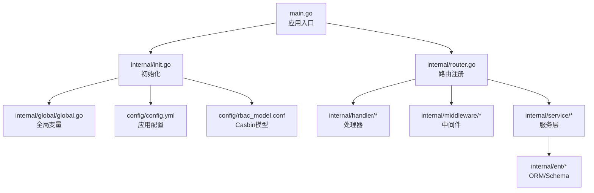
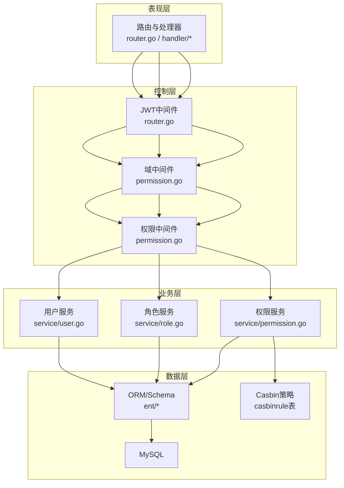
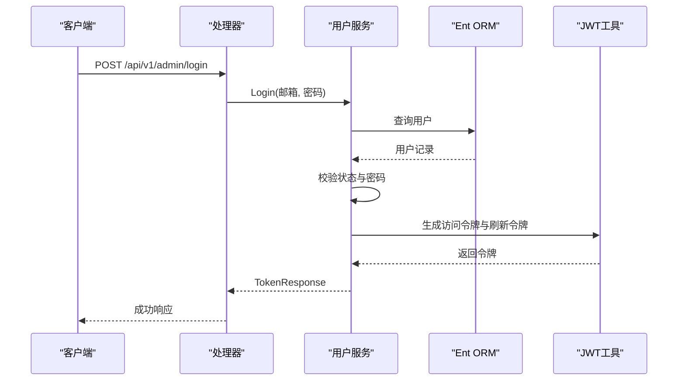
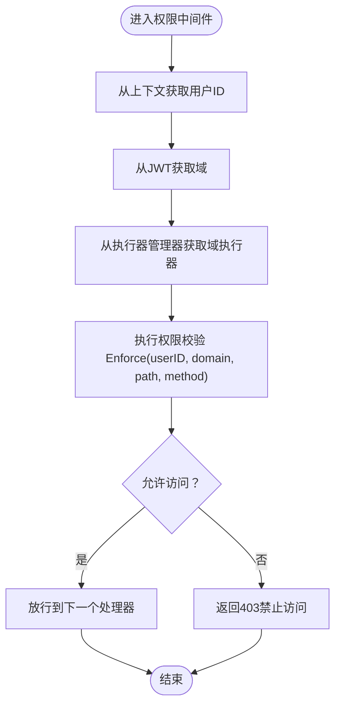
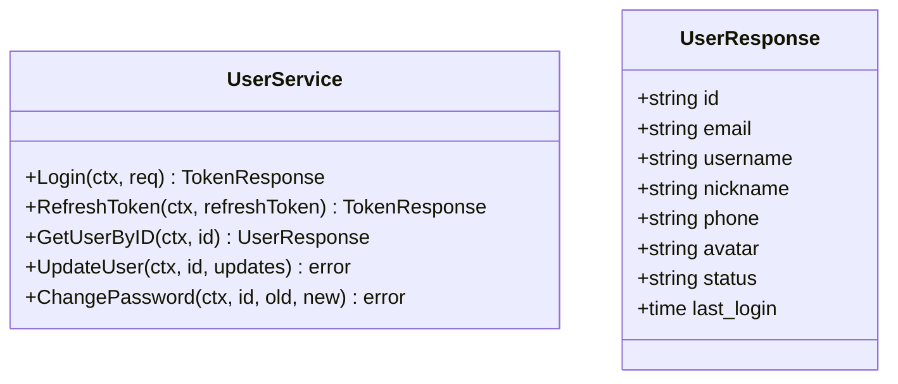
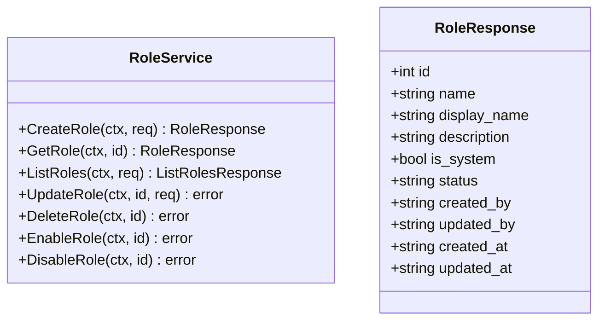
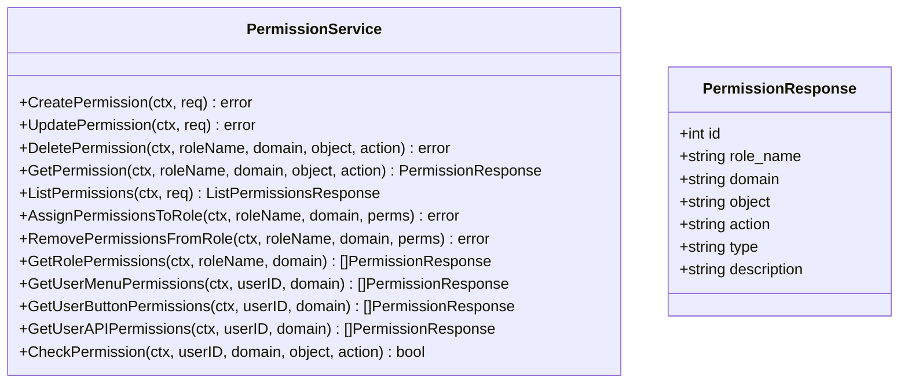
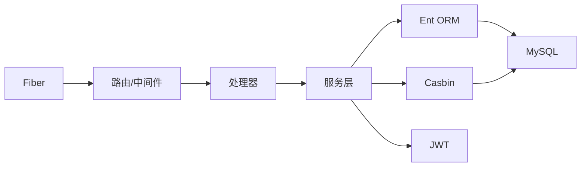

# 项目概述

<cite>
**本文档引用的文件**
- [main.go](file://main.go)
- [init.go](file://internal/init.go)
- [router.go](file://internal/router.go)
- [config.yml](file://config/config.yml)
- [rbac_model.conf](file://config/rbac_model.conf)
- [global.go](file://internal/global/global.go)
- [permission.go](file://internal/middleware/permission.go)
- [public.go](file://internal/handler/public.go)
- [user.go](file://internal/service/user.go)
- [role.go](file://internal/service/role.go)
- [permission.go](file://internal/service/permission.go)
- [user.go](file://internal/ent/schema/user.go)
- [role.go](file://internal/ent/schema/role.go)
- [casbinrule.go](file://internal/ent/schema/casbinrule.go)
- [go.mod](file://go.mod)
</cite>

## 目录
1. [简介](#简介)
2. [项目结构](#项目结构)
3. [核心组件](#核心组件)
4. [架构总览](#架构总览)
5. [详细组件分析](#详细组件分析)
6. [依赖关系分析](#依赖关系分析)
7. [性能考虑](#性能考虑)
8. [故障排查指南](#故障排查指南)
9. [结论](#结论)

## 简介
本项目是一个基于 Go 语言构建的企业级后台管理系统，采用 Fiber 框架作为 Web 服务器，Ent ORM 管理数据模型与迁移，Casbin 作为统一的权限控制引擎，结合 JWT 实现认证与多域权限控制。系统通过清晰的分层设计与中间件机制，提供用户管理、角色管理、权限控制等核心能力，并支持多域隔离与灵活的权限模型。

系统设计理念：
- 认证与授权分离：JWT 负责身份认证，Casbin 负责权限授权。
- 多域支持：通过域（domain）维度隔离不同租户或业务域的权限策略。
- 渐进式权限：支持 API、菜单、按钮三类权限的细粒度控制。
- 易扩展：基于 Ent 的 Schema 定义与 Casbin 适配器，便于扩展新的实体与权限规则。

## 项目结构
项目采用按职责分层的组织方式，主要目录与职责如下：
- internal：核心业务逻辑
  - handler：HTTP 请求处理器，负责参数解析、调用服务层并返回响应
  - service：业务服务层，封装领域逻辑与数据访问
  - middleware：中间件，如权限校验、域解析等
  - ent：Ent 自动生成的 ORM 层及 Schema 定义
  - global：全局变量与共享组件（如 ORM 客户端、Casbin 执行器管理器）
  - router：路由注册与分组
  - init：应用初始化流程（数据库、Casbin）
- config：配置文件（应用、数据库、缓存、Redis、文件系统、Casbin 模型）
- docs：Swagger 文档
- data：日志与存储目录
- .trae：文档与规则（可能用于文档生成或规则管理）

**图表来源**
- [main.go:43-89](file://main.go#L43-L89)
- [init.go:17-65](file://internal/init.go#L17-L65)
- [router.go:14-72](file://internal/router.go#L14-L72)
- [global.go:10-14](file://internal/global/global.go#L10-L14)

**章节来源**
- [main.go:43-89](file://main.go#L43-L89)
- [init.go:17-65](file://internal/init.go#L17-L65)
- [router.go:14-72](file://internal/router.go#L14-L72)

## 核心组件
- 应用入口与引导
  - main.go：初始化 Bootstrap，注册中间件、路由与清理函数，托管静态资源与 SPA 回退
- 初始化流程
  - init.go：初始化数据库（Ent）、创建表结构；初始化 Casbin（适配器+执行器管理器）
- 路由与中间件
  - router.go：API v1 分组、公开接口与鉴权接口分组、JWT 中间件、域中间件、权限中间件
  - permission.go：权限中间件实现，基于 Casbin 执行器进行策略校验
- 服务层
  - user.go：用户登录、刷新令牌、信息查询与更新、密码修改
  - role.go：角色创建、查询、列表、更新、删除、启停
  - permission.go：权限创建、更新、删除、查询、角色权限分配/移除、用户权限查询
- 数据模型
  - user.go、role.go、casbinrule.go：用户、角色、Casbin 策略的 Ent Schema 定义

**章节来源**
- [main.go:43-89](file://main.go#L43-L89)
- [init.go:17-65](file://internal/init.go#L17-L65)
- [router.go:14-72](file://internal/router.go#L14-L72)
- [permission.go:11-69](file://internal/middleware/permission.go#L11-L69)
- [user.go:27-394](file://internal/service/user.go#L27-L394)
- [role.go:25-396](file://internal/service/role.go#L25-L396)
- [permission.go:92-671](file://internal/service/permission.go#L92-L671)
- [user.go:17-104](file://internal/ent/schema/user.go#L17-L104)
- [role.go:10-73](file://internal/ent/schema/role.go#L10-L73)
- [casbinrule.go:9-37](file://internal/ent/schema/casbinrule.go#L9-L37)

## 架构总览
系统采用典型的分层架构：
- 表现层：Fiber 路由与处理器
- 控制层：中间件（JWT、域、权限）
- 业务层：服务层封装领域逻辑
- 数据层：Ent ORM + MySQL；Casbin 策略持久化于数据库

**图表来源**
- [router.go:14-72](file://internal/router.go#L14-L72)
- [permission.go:11-69](file://internal/middleware/permission.go#L11-L69)
- [user.go:36-44](file://internal/service/user.go#L36-L44)
- [role.go:39-48](file://internal/service/role.go#L39-L48)
- [permission.go:115-125](file://internal/service/permission.go#L115-L125)
- [casbinrule.go:9-37](file://internal/ent/schema/casbinrule.go#L9-L37)

## 详细组件分析

### 认证与会话（JWT）
- 登录流程
  - 处理器接收邮箱+密码，调用用户服务进行校验
  - 服务层查询用户、校验状态与密码，生成访问令牌与刷新令牌
  - 令牌中包含用户ID、主题、签发方、域、过期时间、签发时间、令牌类型等声明
- 刷新令牌
  - 使用刷新令牌解析出用户信息，重新签发访问令牌
- 中间件
  - JWT 中间件从请求头解析并验证令牌，将用户信息注入上下文

**图表来源**
- [public.go:22-45](file://internal/handler/public.go#L22-L45)
- [user.go:127-206](file://internal/service/user.go#L127-L206)

**章节来源**
- [public.go:22-45](file://internal/handler/public.go#L22-L45)
- [user.go:127-206](file://internal/service/user.go#L127-L206)

### 权限控制（Casbin + RBAC）
- 模型与策略
  - rbac_model.conf 定义了请求、策略、角色关系、效果与匹配器
  - casbinrule 表存储策略（Ptype/V0-V5），对应角色、域、对象、动作、类型、描述
- 中间件校验
  - 从 JWT 获取域与用户ID
  - 从 EnforcerManager 获取指定域的执行器
  - 使用 Enforce(sub, dom, obj, act) 进行权限判断
- 服务层能力
  - 支持为角色分配/移除权限、查询角色权限
  - 支持查询用户菜单、按钮、API 权限
  - 支持按用户ID直接校验某条权限

**图表来源**
- [permission.go:11-69](file://internal/middleware/permission.go#L11-L69)
- [rbac_model.conf:1-15](file://config/rbac_model.conf#L1-L15)
- [casbinrule.go:14-24](file://internal/ent/schema/casbinrule.go#L14-L24)

**章节来源**
- [permission.go:11-69](file://internal/middleware/permission.go#L11-L69)
- [rbac_model.conf:1-15](file://config/rbac_model.conf#L1-L15)
- [casbinrule.go:14-24](file://internal/ent/schema/casbinrule.go#L14-L24)

### 用户管理
- 功能点
  - 登录、刷新令牌、获取/更新个人信息、修改密码
- 数据模型
  - 用户实体包含邮箱、用户名、昵称、UID、密码盐、头像、手机、状态、最后登录时间等
- 服务层要点
  - 密码加密与校验
  - 状态校验（仅活跃用户可登录）
  - 最后登录时间更新

**图表来源**
- [user.go:27-394](file://internal/service/user.go#L27-L394)
- [user.go:17-104](file://internal/ent/schema/user.go#L17-L104)

**章节来源**
- [user.go:27-394](file://internal/service/user.go#L27-L394)
- [user.go:17-104](file://internal/ent/schema/user.go#L17-L104)

### 角色管理
- 功能点
  - 创建、查询、列表、更新、删除、启停角色
- 业务约束
  - 系统内置角色不可删除与修改显示名
  - 角色被用户使用时不可删除
  - 角色状态变更需遵循业务规则

**图表来源**
- [role.go:25-396](file://internal/service/role.go#L25-L396)
- [role.go:10-73](file://internal/ent/schema/role.go#L10-L73)

**章节来源**
- [role.go:25-396](file://internal/service/role.go#L25-L396)
- [role.go:10-73](file://internal/ent/schema/role.go#L10-L73)

### 权限管理
- 功能点
  - 权限 CRUD、角色权限分配/移除、用户权限查询（菜单、按钮、API）
- 数据模型
  - CasbinRule 存储策略，字段 V0-V5 对应角色、域、对象、动作、类型、描述
- 服务层要点
  - 自动推断权限类型（API/菜单/按钮）
  - 基于用户角色集合查询其可访问的权限

**图表来源**
- [permission.go:92-671](file://internal/service/permission.go#L92-L671)
- [casbinrule.go:9-37](file://internal/ent/schema/casbinrule.go#L9-L37)

**章节来源**
- [permission.go:92-671](file://internal/service/permission.go#L92-L671)
- [casbinrule.go:9-37](file://internal/ent/schema/casbinrule.go#L9-L37)

## 依赖关系分析
- 技术栈
  - Fiber：高性能 Web 框架，提供路由、中间件与请求处理
  - Ent：声明式 ORM，自动生成客户端与 Schema，支持复杂查询与事务
  - Casbin：开源访问控制框架，支持多种模型（RBAC/ABAC 等）
  - JWT：令牌认证，携带用户域信息
  - MySQL：关系型数据库
- 组件耦合
  - 服务层依赖全局 ORM 客户端
  - 中间件依赖全局执行器管理器与 JWT 工具
  - 路由层组装处理器、服务层与中间件

**图表来源**
- [go.mod:5-13](file://go.mod#L5-L13)
- [router.go:14-72](file://internal/router.go#L14-L72)
- [global.go:10-14](file://internal/global/global.go#L10-L14)

**章节来源**
- [go.mod:5-13](file://go.mod#L5-L13)
- [router.go:14-72](file://internal/router.go#L14-L72)
- [global.go:10-14](file://internal/global/global.go#L10-L14)

## 性能考虑
- 中间件链路短、职责单一，减少不必要的计算
- Casbin 执行器按域缓存，建议高频域开启自动加载
- Ent 查询使用索引与条件过滤，避免全表扫描
- JWT 仅做轻量校验，复杂权限在中间件集中处理
- 建议对热点接口增加缓存（如用户权限清单），降低数据库压力

## 故障排查指南
- 认证失败
  - 检查请求头 Authorization 是否为 Bearer 令牌
  - 核对令牌签名密钥与过期时间
- 权限不足
  - 确认用户角色与域信息正确
  - 检查 Casbin 策略是否已为角色分配相应权限
- 数据库问题
  - 确认连接配置与表结构迁移完成
  - 检查索引与唯一约束是否满足业务需求
- 日志定位
  - 查看应用日志文件路径配置，定位错误堆栈

**章节来源**
- [config.yml:11-18](file://config/config.yml#L11-L18)
- [permission.go:11-69](file://internal/middleware/permission.go#L11-L69)
- [user.go:127-206](file://internal/service/user.go#L127-L206)

## 结论
本项目通过 Fiber、Ent、Casbin、JWT 的组合，构建了一个高内聚、低耦合的企业级后台管理系统。系统具备完善的认证与权限控制能力，支持多域隔离与细粒度权限管理，适合在需要严格权限控制与可扩展性的企业场景中部署与演进。