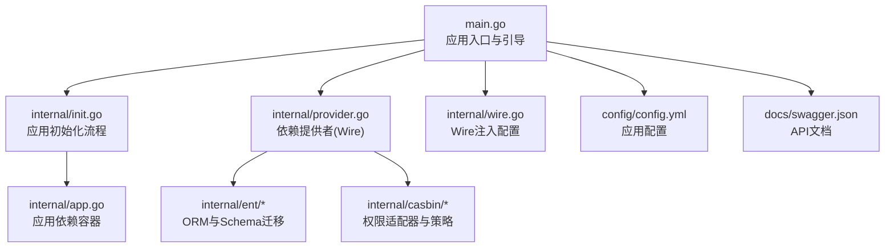
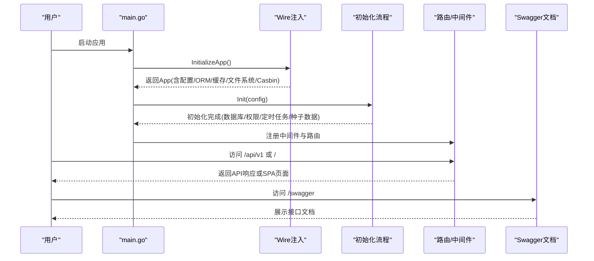
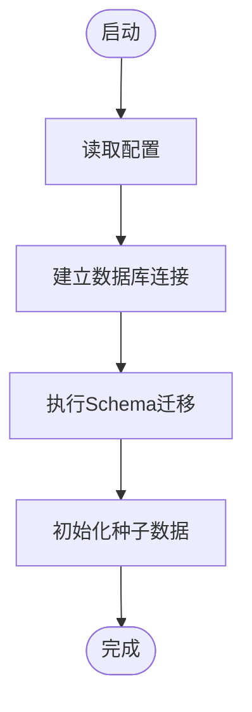
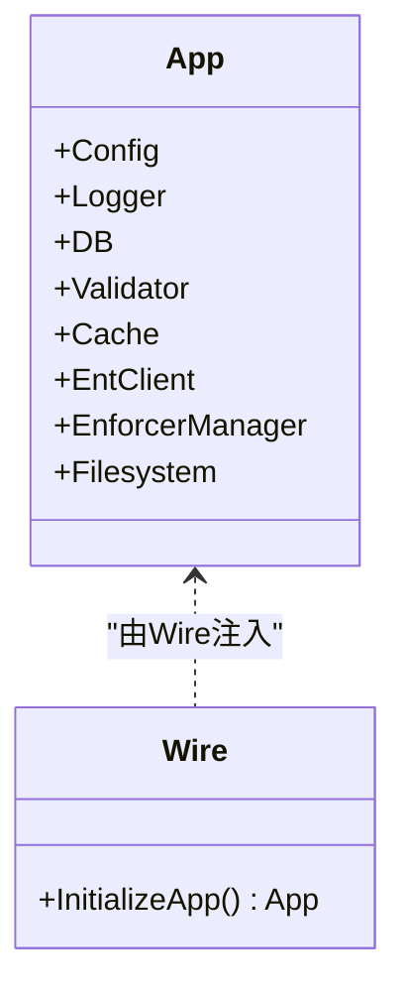
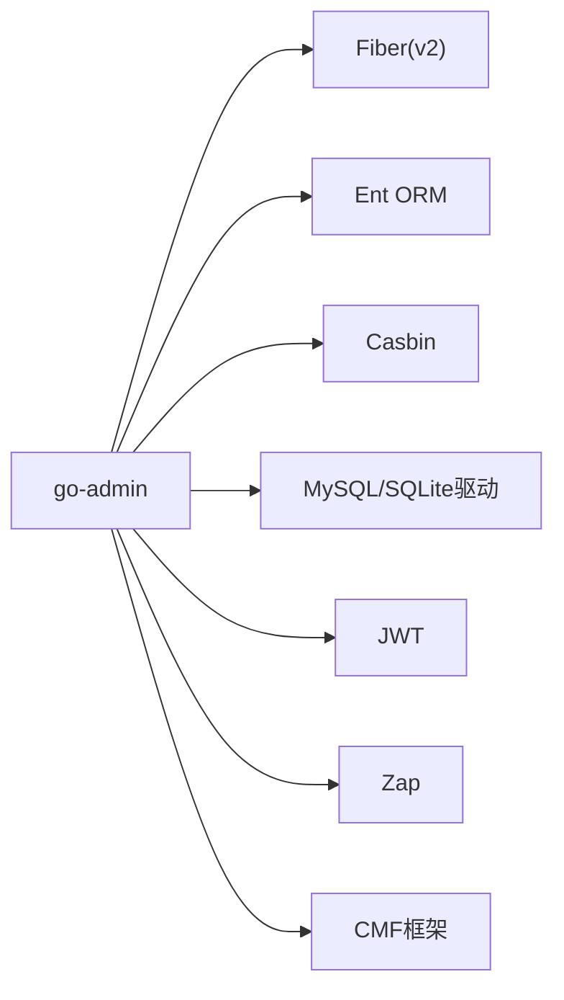

# 快速开始

<cite>
**本文引用的文件**
- [main.go](file://main.go)
- [go.mod](file://go.mod)
- [config.yml](file://config/config.yml)
- [app.go](file://internal/app.go)
- [init.go](file://internal/init.go)
- [provider.go](file://internal/provider.go)
- [wire.go](file://internal/wire.go)
- [.golangci.yml](file://.golangci.yml)
- [swagger.json](file://docs/swagger.json)
</cite>

## 目录
1. [简介](#简介)
2. [项目结构](#项目结构)
3. [核心组件](#核心组件)
4. [架构总览](#架构总览)
5. [详细组件分析](#详细组件分析)
6. [依赖分析](#依赖分析)
7. [性能考虑](#性能考虑)
8. [故障排查指南](#故障排查指南)
9. [结论](#结论)
10. [附录](#附录)

## 简介
本指南面向首次接触 Go Admin 管理系统的用户，帮助你在最短时间内完成环境准备、项目构建、数据库初始化与配置、启动运行，并对管理界面、API 文档与基础功能进行验证。同时提供 Docker 部署思路与本地开发环境建议，以及常见问题排查与性能优化建议。

## 项目结构
Go Admin 采用模块化组织方式，核心入口位于根目录的主程序文件，配置集中在 config 目录，内部逻辑按领域拆分至 internal 目录，包含初始化、依赖注入、路由注册、中间件、服务层、任务调度、权限控制等模块；API 文档由 Swagger 生成并嵌入。

图示来源
- [main.go:47-107](file://main.go#L47-L107)
- [init.go:39-96](file://internal/init.go#L39-L96)
- [provider.go:17-46](file://internal/provider.go#L17-L46)
- [wire.go:22-37](file://internal/wire.go#L22-L37)
- [config.yml:1-143](file://config/config.yml#L1-L143)
- [swagger.json:1-200](file://docs/swagger.json#L1-L200)

章节来源
- [main.go:1-108](file://main.go#L1-L108)
- [config.yml:1-143](file://config/config.yml#L1-L143)

## 核心组件
- 应用入口与引导：负责初始化依赖、挂载中间件、注册路由、启动服务。
- 配置中心：集中管理应用、日志、数据库、缓存、Redis、文件系统、Casbin 等配置。
- 初始化流程：数据库连接与迁移、Casbin 权限初始化、定时任务、密钥与防重放机制、种子数据与字典数据初始化。
- 依赖注入：通过 Wire 组合日志、ORM、校验器、缓存、文件系统、Ent ORM 客户端、Casbin 管理器等。
- API 文档：Swagger 生成并嵌入 JSON，便于调试与联调。

章节来源
- [main.go:47-107](file://main.go#L47-L107)
- [config.yml:1-143](file://config/config.yml#L1-L143)
- [init.go:39-96](file://internal/init.go#L39-L96)
- [provider.go:17-46](file://internal/provider.go#L17-L46)
- [wire.go:22-37](file://internal/wire.go#L22-L37)
- [swagger.json:1-200](file://docs/swagger.json#L1-L200)

## 架构总览
下图展示了从应用启动到服务可用的关键交互：入口初始化 -> 依赖注入 -> 数据库与权限初始化 -> 中间件与路由 -> API 文档与前端静态资源。

图示来源
- [main.go:47-107](file://main.go#L47-L107)
- [init.go:39-96](file://internal/init.go#L39-L96)
- [swagger.json:1-200](file://docs/swagger.json#L1-L200)

## 详细组件分析

### 环境准备与依赖
- Go 版本要求：项目使用 Go 1.25.1，请确保本地安装对应版本。
- 数据库：默认使用 MySQL，需提前安装并准备好数据库与账号；如需 SQLite，可在配置中切换驱动。
- 缓存与文件系统：可选 Redis 缓存；文件系统支持本地磁盘与 S3。
- 其他：需要可写目录用于日志与文件存储。

章节来源
- [go.mod:3](file://go.mod#L3)
- [config.yml:19-31](file://config/config.yml#L19-L31)
- [config.yml:42-58](file://config/config.yml#L42-L58)
- [config.yml:60-76](file://config/config.yml#L60-L76)

### 项目克隆与依赖安装
- 克隆仓库后，执行依赖安装以拉取模块与替换路径。
- 若使用本地替换模块（cmf/ent），请确保替换路径指向有效目录。

章节来源
- [go.mod:126-128](file://go.mod#L126-L128)

### 数据库初始化与配置
- 数据库连接：在配置文件中设置默认连接参数（驱动、主机、端口、用户名、密码、数据库名、表前缀等）。
- Schema 迁移：通过 Wire 提供的 ORM 客户端自动执行迁移，确保表结构与字段更新。
- 种子数据：启动时自动创建“超级管理员”角色、用户、关联关系与 Casbin 权限策略；若已存在则跳过。

图示来源
- [provider.go:17-36](file://internal/provider.go#L17-L36)
- [init.go:98-116](file://internal/init.go#L98-L116)
- [init.go:134-310](file://internal/init.go#L134-L310)

章节来源
- [config.yml:19-31](file://config/config.yml#L19-L31)
- [provider.go:17-36](file://internal/provider.go#L17-L36)
- [init.go:98-116](file://internal/init.go#L98-L116)
- [init.go:134-310](file://internal/init.go#L134-L310)

### 配置文件设置
- 应用：端口、调试模式、Swagger 开关、登录过期时间等。
- 日志：输出到文件与控制台、滚动策略。
- 数据库：默认连接、驱动与表前缀。
- 缓存：内存缓存与 Redis 配置。
- 文件系统：本地磁盘与 S3 配置。
- Casbin：多域模型配置与自动加载策略。

章节来源
- [config.yml:1-143](file://config/config.yml#L1-L143)

### 依赖注入与应用容器
- 通过 Wire 组合日志、ORM、校验器、缓存、文件系统、Ent ORM 客户端、Casbin 管理器等。
- 应用容器封装了这些依赖，供后续初始化与运行阶段使用。

图示来源
- [app.go:15-26](file://internal/app.go#L15-L26)
- [wire.go:22-37](file://internal/wire.go#L22-L37)

章节来源
- [app.go:15-26](file://internal/app.go#L15-L26)
- [wire.go:22-37](file://internal/wire.go#L22-L37)

### 中间件与路由
- 静态资源与 SPA 支持：通过文件系统中间件提供前端打包产物；API 请求透传，非 API 请求回退到 index.html。
- 路由注册：由引导器统一注册，结合权限中间件实现受控访问。

章节来源
- [main.go:62-96](file://main.go#L62-L96)

### API 文档与 Swagger
- Swagger 文档随应用启动提供，可通过配置开关启用/禁用。
- 文档定义了基础路径、认证方式与大量接口示例，便于联调与测试。

章节来源
- [main.go:24-43](file://main.go#L24-L43)
- [swagger.json:1-200](file://docs/swagger.json#L1-L200)

## 依赖分析
- 运行时依赖：Fiber Web 框架、Ent ORM、Casbin 权限、MySQL/SQLite 驱动、JWT、Zap 日志、CMF 基础框架等。
- 构建与工具：Wire 依赖注入、Swag 文档生成、GolangCI-Lint 代码质量检查。

图示来源
- [go.mod:5-19](file://go.mod#L5-L19)

章节来源
- [go.mod:1-128](file://go.mod#L1-L128)
- [.golangci.yml:1-38](file://.golangci.yml#L1-L38)

## 性能考虑
- 数据库连接池与迁移策略：合理设置连接数与生命周期，避免频繁重建连接。
- 缓存：优先使用内存缓存，高并发场景建议启用 Redis 并配置合适的 TTL 与连接池。
- 日志：生产环境建议仅开启文件输出并配置滚动策略，避免控制台输出带来的开销。
- 前端静态资源：确保构建产物完整，减少不必要的网络往返。
- 定时任务：合理安排任务频率与日志保留周期，避免磁盘压力过大。

## 故障排查指南
- 启动失败（无法连接数据库）
  - 检查数据库连接参数与账号权限，确认数据库服务正常。
  - 如使用 SQLite，请确认驱动与路径正确。
- 启动失败（Schema 迁移失败）
  - 查看迁移日志，确认表前缀与权限；必要时手动清理或调整迁移策略。
- Swagger 无法访问
  - 确认 Swagger 开关已启用，访问基础路径与认证头是否正确。
- 权限相关问题
  - 检查 Casbin 策略是否加载成功，确认用户 UID 与角色映射是否存在。
- 性能问题
  - 检查日志级别与输出位置，评估缓存命中率与数据库查询计划。
- 代码质量检查
  - 使用 GolangCI-Lint 按配置运行，关注生成代码目录的排除规则。

章节来源
- [config.yml:19-31](file://config/config.yml#L19-L31)
- [config.yml:32-58](file://config/config.yml#L32-L58)
- [init.go:118-132](file://internal/init.go#L118-L132)
- [swagger.json:1-200](file://docs/swagger.json#L1-L200)
- [.golangci.yml:1-38](file://.golangci.yml#L1-L38)

## 结论
按照本指南完成环境准备、配置与初始化后，你将能够顺利启动 Go Admin 系统，并通过管理界面与 Swagger 文档进行基础验证。建议在开发环境中先完成本地验证，再逐步引入 Redis、S3 等生产级组件，并持续关注日志与性能指标。

## 附录

### 一键启动命令
- 在项目根目录执行应用启动命令，等待初始化完成并监听端口。
- 访问管理界面与 API 文档，确认服务可用。

章节来源
- [main.go:47-107](file://main.go#L47-L107)

### 首次运行验证清单
- 访问管理界面，确认页面加载正常。
- 访问 API 文档，确认接口列表与认证方式。
- 登录系统，尝试调用受保护接口，确认鉴权生效。
- 查看日志输出，确认初始化流程无错误。

章节来源
- [swagger.json:1-200](file://docs/swagger.json#L1-L200)
- [init.go:39-96](file://internal/init.go#L39-L96)

### Docker 部署建议
- 基础镜像：选择官方 Go 或 Alpine 作为基础镜像，安装所需系统依赖。
- 构建产物：将编译好的二进制与前端打包产物一并复制到镜像中。
- 环境变量：通过环境变量覆盖配置文件中的敏感项（数据库、Redis、密钥等）。
- 健康检查：添加健康检查端点，确保容器状态稳定。
- 存储：挂载持久化卷用于日志与文件存储。

[本节为概念性部署建议，不直接对应具体源文件]

### 本地开发环境推荐
- IDE：建议使用具备 Go 插件的编辑器，启用 LSP 与格式化。
- 调试：利用断点与日志定位问题，关注初始化阶段的错误信息。
- 代码规范：遵循 GolangCI-Lint 规则，保持一致的风格与质量。

章节来源
- [.golangci.yml:1-38](file://.golangci.yml#L1-L38)