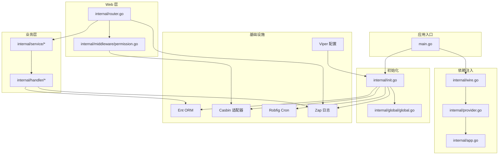
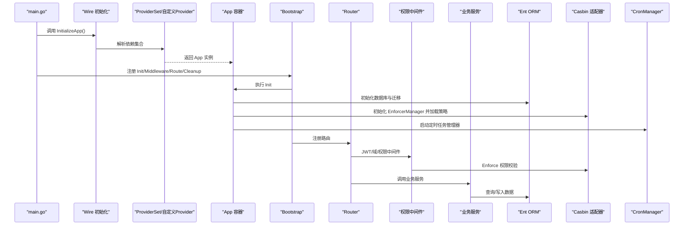
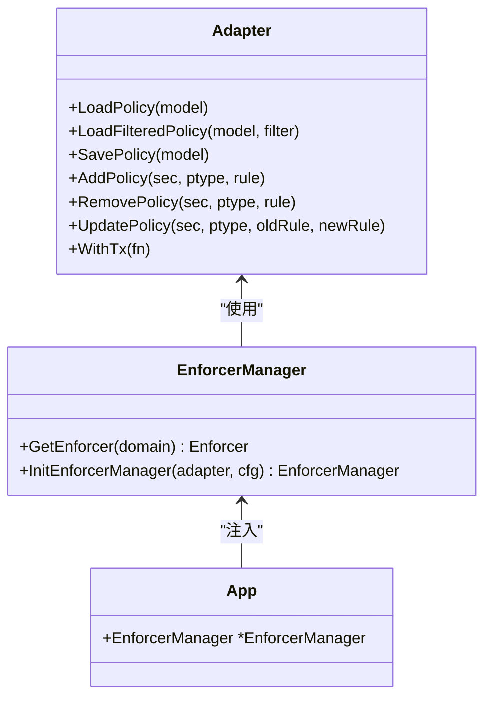
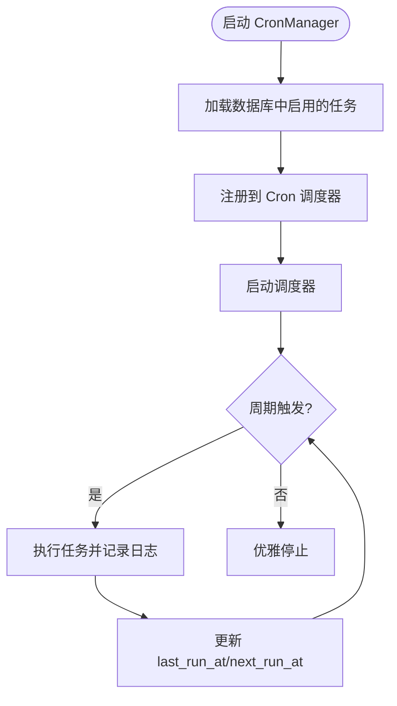
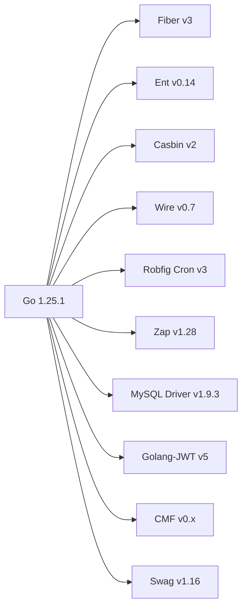

# 技术栈概览

<cite>
**本文档引用的文件**
- [go.mod](file://go.mod)
- [main.go](file://main.go)
- [internal/app.go](file://internal/app.go)
- [internal/provider.go](file://internal/provider.go)
- [internal/wire.go](file://internal/wire.go)
- [internal/init.go](file://internal/init.go)
- [internal/router.go](file://internal/router.go)
- [internal/casbin/adapter/adapter.go](file://internal/casbin/adapter/adapter.go)
- [internal/cron/manager.go](file://internal/cron/manager.go)
- [config/config.yml](file://config/config.yml)
- [.golangci.yml](file://.golangci.yml)
- [internal/tasks/registry.go](file://internal/tasks/registry.go)
- [internal/middleware/permission.go](file://internal/middleware/permission.go)
- [internal/global/global.go](file://internal/global/global.go)
</cite>

## 目录
1. [简介](#简介)
2. [项目结构](#项目结构)
3. [核心组件](#核心组件)
4. [架构总览](#架构总览)
5. [详细组件分析](#详细组件分析)
6. [依赖关系分析](#依赖关系分析)
7. [性能考量](#性能考量)
8. [故障排查指南](#故障排查指南)
9. [结论](#结论)
10. [附录](#附录)

## 简介
本技术栈概览面向 Go Admin 管理系统，系统采用 Go 语言与现代化生态构建，核心技术栈包括：
- Web 框架：Fiber v3（高性能 HTTP 框架）
- ORM：Ent v0.14（类型安全、Schema 驱动的数据库 ORM）
- 权限控制：Casbin v2（基于模型的灵活 RBAC/ABAC 权限引擎）
- 依赖注入：Google Wire v0.7（编译期依赖注入，零运行时反射）
- 定时任务：Robfig Cron v3（Cron 表达式调度器）
- 日志系统：Zap v1.28（结构化高性能日志）
- 缓存：多存储支持（内存/Redis）
- 配置：Viper（YAML 配置文件）
- Swagger 文档：Swag v1.16
- JWT：Golang-JWT v5（令牌认证）

技术选型目标：
- 高性能与高并发：Fiber 提供极低延迟与高吞吐
- 类型安全与可维护性：Ent 的 Schema 驱动与强类型查询
- 灵活权限模型：Casbin 支持多域、多模型与动态策略
- 易于扩展与测试：Wire 提供清晰的依赖图，Robfig Cron 支持任务生命周期管理
- 开发体验：Zap 结构化日志、Swag 文档自动生成、GolangCI Linters

## 项目结构
项目采用按功能域划分的目录组织方式，核心模块如下：
- cmd：命令入口（含主程序）
- config：配置文件（YAML）
- internal：核心业务逻辑
  - app.go：应用依赖容器定义
  - provider.go：Wire Provider 集合
  - wire.go：依赖注入装配入口
  - init.go：应用初始化流程（数据库、Casbin、定时任务、种子数据）
  - router.go：路由注册与中间件链
  - middleware：权限中间件
  - handler：HTTP 处理器
  - service：业务服务层
  - ent：Ent 自动生成的实体与查询
  - casbin/adapter：Casbin 适配器
  - cron：定时任务管理器
  - tasks：Go task 注册表
  - utils：工具类
  - global：全局共享对象
- docs：Swagger 文档
- data/storage：本地文件存储根目录
- .golangci.yml：代码质量工具配置

**图表来源**
- [main.go:47-107](file://main.go#L47-L107)
- [internal/wire.go:22-37](file://internal/wire.go#L22-L37)
- [internal/provider.go:17-46](file://internal/provider.go#L17-L46)
- [internal/app.go:15-28](file://internal/app.go#L15-L28)
- [internal/init.go:39-96](file://internal/init.go#L39-L96)
- [internal/router.go:16-365](file://internal/router.go#L16-L365)
- [internal/middleware/permission.go:11-80](file://internal/middleware/permission.go#L11-L80)
- [internal/global/global.go:11-16](file://internal/global/global.go#L11-L16)

**章节来源**
- [main.go:1-108](file://main.go#L1-108)
- [internal/app.go:1-28](file://internal/app.go#L1-L28)
- [internal/wire.go:1-38](file://internal/wire.go#L1-L38)
- [internal/provider.go:1-47](file://internal/provider.go#L1-L47)
- [internal/init.go:1-372](file://internal/init.go#L1-L372)
- [internal/router.go:1-365](file://internal/router.go#L1-L365)
- [internal/middleware/permission.go:1-80](file://internal/middleware/permission.go#L1-L80)
- [internal/global/global.go:1-17](file://internal/global/global.go#L1-L17)

## 核心组件
- 应用依赖容器 App：集中管理配置、日志、数据库、验证器、缓存、Ent 客户端、Casbin 执行器、文件系统、SSE Hub、TicketStore 等。
- Wire 依赖注入：通过 provider 组合与 wire.Build 构建完整应用依赖树，支持替换与扩展。
- 初始化流程：统一在 Init 中完成数据库迁移、Casbin 策略加载、定时任务启动、密钥与随机数存储初始化、SSE Hub 初始化、分片上传清理协程启动、种子数据与字典数据初始化。
- 路由与中间件：基于 Fiber v3 的路由分组与中间件链，集成 JWT 认证、权限校验、请求日志、黑名单校验。
- 权限控制：基于 Casbin 的 EnforcerManager，支持多域模型与动态策略加载。
- 定时任务：基于 Robfig Cron 的 CronManager，支持 Shell/Curl/Task 三种执行器与日志保留策略。
- 站内消息与 SSE：支持按用户/角色/全员广播，基于 SSE 实时推送，含消息偏好与免打扰设置。
- 插件系统：支持插件安装、启用、禁用、卸载，通过 UDS/HTTP 反向代理访问插件端点。
- 日志系统：Zap 提供结构化日志输出，支持文件滚动与控制台输出。
- 配置系统：Viper 加载 YAML 配置，支持数据库、缓存、Redis、文件系统、Casbin 多域模型等配置项。

**章节来源**
- [internal/app.go:15-28](file://internal/app.go#L15-L28)
- [internal/provider.go:17-46](file://internal/provider.go#L17-L46)
- [internal/init.go:39-96](file://internal/init.go#L39-L96)
- [internal/router.go:16-365](file://internal/router.go#L16-L365)
- [internal/casbin/adapter/adapter.go:115-175](file://internal/casbin/adapter/adapter.go#L115-L175)
- [internal/cron/manager.go:17-38](file://internal/cron/manager.go#L17-L38)
- [config/config.yml:1-143](file://config/config.yml#L1-L143)

## 架构总览
系统采用“依赖注入 + 初始化流程 + 路由中间件 + 业务服务”的分层架构：
- 入口层：main.go 通过 Wire 初始化应用，注册 Bootstrap 生命周期钩子（初始化、中间件、路由、清理）。
- 依赖层：Wire 通过 ProviderSet 与自定义 Provider 构建 App，提供 Ent、Casbin、缓存、文件系统等依赖。
- 业务层：Router 注册路由组与中间件，Handler 调用 Service，Service 通过 Ent 访问数据库，通过 Casbin 进行权限校验。
- 基础设施层：Zap 日志、Viper 配置、Robfig Cron 定时任务、文件系统抽象。

**图表来源**
- [main.go:47-107](file://main.go#L47-L107)
- [internal/wire.go:22-37](file://internal/wire.go#L22-L37)
- [internal/provider.go:17-46](file://internal/provider.go#L17-L46)
- [internal/init.go:39-96](file://internal/init.go#L39-L96)
- [internal/router.go:16-365](file://internal/router.go#L16-L365)
- [internal/middleware/permission.go:11-80](file://internal/middleware/permission.go#L11-L80)

## 详细组件分析

### Fiber Web 框架
- 作用：高性能 HTTP 框架，提供路由、中间件、静态文件服务、Swagger 文档等能力。
- 关键点：
  - 路由分组与版本控制（/api/v1/admin）
  - 中间件链：请求日志、JWT 认证、域中间件、权限中间件
  - SPA 支持：文件系统中间件与通用处理程序
- 性能优势：零分配路由、内置连接池、异步中间件链

**章节来源**
- [internal/router.go:16-365](file://internal/router.go#L16-L365)
- [main.go:62-94](file://main.go#L62-L94)

### Ent ORM
- 作用：类型安全的数据库 ORM，Schema 驱动，自动迁移与事务支持。
- 关键点：
  - 表前缀延迟初始化，支持多库多前缀
  - 自动迁移（带索引/列删除选项）
  - 事务封装与批量写入
- 优势：类型安全、Schema 即文档、强约束、易扩展

**章节来源**
- [internal/provider.go:17-36](file://internal/provider.go#L17-L36)
- [internal/init.go:98-116](file://internal/init.go#L98-L116)
- [internal/casbin/adapter/adapter.go:304-325](file://internal/casbin/adapter/adapter.go#L304-L325)

### Casbin 权限控制
- 作用：基于模型的灵活权限引擎，支持 RBAC/ABAC，多域模型。
- 关键点：
  - 自定义适配器，基于 Ent 存储策略规则
  - 支持过滤加载、批量增删改、事务一致性
  - 多域配置（domains_default、domains 列表）
- 优势：模型可配置、策略可热更新、支持复杂权限场景

**图表来源**
- [internal/casbin/adapter/adapter.go:115-175](file://internal/casbin/adapter/adapter.go#L115-L175)
- [internal/provider.go:38-46](file://internal/provider.go#L38-L46)
- [internal/app.go:23](file://internal/app.go#L23)

**章节来源**
- [internal/casbin/adapter/adapter.go:115-175](file://internal/casbin/adapter/adapter.go#L115-L175)
- [internal/provider.go:38-46](file://internal/provider.go#L38-L46)
- [config/config.yml:77-143](file://config/config.yml#L77-L143)

### Google Wire 依赖注入
- 作用：编译期依赖注入，零运行时反射，提升性能与可维护性。
- 关键点：
  - ProviderSet：配置、日志、ORM、验证器、缓存、文件系统
  - 自定义 Provider：Ent 客户端、Casbin 适配器、EnforcerManager
  - InitializeApp：一次性装配 App
- 优势：显式依赖、可测试性强、可替换 Provider

**章节来源**
- [internal/wire.go:22-37](file://internal/wire.go#L22-L37)
- [internal/provider.go:17-46](file://internal/provider.go#L17-L46)
- [internal/app.go:15-28](file://internal/app.go#L15-L28)

### Robfig Cron 定时任务
- 作用：基于 Cron 表达式的任务调度器，支持 Shell/Curl/Task 三种执行器。
- 关键点：
  - CronManager：注册、启动、停止、立即执行、日志清理
  - 任务类型：shell/curl/task
  - 日志保留策略：按时间窗口清理
- 优势：表达式简洁、任务生命周期管理完善、日志可观测

**图表来源**
- [internal/cron/manager.go:40-77](file://internal/cron/manager.go#L40-L77)
- [internal/cron/manager.go:154-221](file://internal/cron/manager.go#L154-L221)

**章节来源**
- [internal/cron/manager.go:17-38](file://internal/cron/manager.go#L17-L38)
- [internal/cron/manager.go:40-77](file://internal/cron/manager.go#L40-L77)
- [internal/cron/manager.go:154-221](file://internal/cron/manager.go#L154-L221)

### Zap 日志系统
- 作用：高性能结构化日志，支持文件滚动与控制台输出。
- 关键点：
  - 配置项：文件路径、最大大小、备份数量、保留天数
  - 在 main 与初始化流程中设置默认 Logger
- 优势：零分配、可配置、可扩展

**章节来源**
- [main.go:55-57](file://main.go#L55-L57)
- [config/config.yml:11-18](file://config/config.yml#L11-L18)

### 配置系统（Viper + YAML）
- 作用：集中式配置管理，支持多存储（内存/Redis）与多域 Casbin 模型。
- 关键点：
  - app：端口、调试、超时、Swagger、密钥、登录过期
  - database：驱动、主机、端口、用户、密码、库名、SSL、表前缀
  - cache/redis：存储驱动与连接参数
  - filesystem：本地/云存储盘配置
  - casbin：多域模型配置（domains_default、domains 列表）
- 优势：配置即文档、热更新友好、多环境支持

**章节来源**
- [config/config.yml:1-143](file://config/config.yml#L1-L143)

### 权限中间件与路由
- 作用：JWT 认证 + 域中间件 + Casbin 权限校验，统一拦截未授权访问。
- 关键点：
  - 从 JWT 提取用户 ID 与域
  - 调用 Enforcer.Enforce 进行权限判断
  - 将用户 ID 与域注入 Locals 供后续处理器使用
- 优势：统一鉴权入口、可扩展中间件链

**章节来源**
- [internal/middleware/permission.go:11-80](file://internal/middleware/permission.go#L11-L80)
- [internal/router.go:54-70](file://internal/router.go#L54-L70)

### 初始化流程
- 作用：应用启动时的统一初始化，保证依赖可用与系统就绪。
- 关键点：
  - 数据库：Ent 客户端初始化与迁移
  - Casbin：适配器创建与 EnforcerManager 初始化
  - 定时任务：CronManager 启动并加载启用任务
  - 安全：NonceStore 与 KeyManager 初始化
  - 种子数据：超级管理员、角色、权限规则、字典数据
- 优势：幂等、可回滚、可观测

**章节来源**
- [internal/init.go:39-96](file://internal/init.go#L39-L96)
- [internal/init.go:134-310](file://internal/init.go#L134-L310)
- [internal/init.go:312-371](file://internal/init.go#L312-L371)

## 依赖关系分析
- 语言与版本：Go 1.25.1
- 主要依赖：
  - entgo.io/ent v0.14.5（ORM）
  - github.com/casbin/casbin/v2 v2.135.0（权限）
  - github.com/go-sql-driver/mysql v1.9.3（MySQL 驱动）
  - github.com/gofiber/fiber/v3 v3.2.0（Web 框架）
  - github.com/golang-jwt/jwt/v5 v5.3.1（JWT）
  - github.com/google/wire v0.7.0（依赖注入）
  - github.com/google/uuid v1.6.0（UUID 生成）
  - github.com/mattn/go-sqlite3 v1.14.32（SQLite 驱动，间接）
  - github.com/pkg/errors v0.9.1（错误包装）
  - github.com/robfig/cron/v3 v3.0.1（定时任务）
  - github.com/swaggo/swag v1.16.4（Swagger 文档）
  - github.com/wuwuseo/cmf v0.0.0（CMF 基础设施）
  - go.uber.org/zap v1.28.0（日志）
- 替换依赖：github.com/wuwuseo/cmf 与 github.com/wuwuseo/ent 指向本地路径，便于二次开发与定制

**图表来源**
- [go.mod:3](file://go.mod#L3)
- [go.mod:5-19](file://go.mod#L5-L19)

**章节来源**
- [go.mod:1-145](file://go.mod#L1-L145)

## 性能考量
- Fiber：零分配路由、连接复用、中间件链异步化，适合高并发 API。
- Ent：Schema 驱动，编译期生成查询，减少运行时反射；支持批量写入与事务，降低网络往返。
- Casbin：策略加载支持过滤与批量，建议高频域启用自动加载；策略变更时注意 LoadPolicy 的成本。
- Cron：秒级调度，任务执行与日志写入需关注磁盘 IO；建议合理设置日志保留天数。
- 缓存：内存/Redis 双存储，建议对热点数据开启缓存；注意缓存一致性与失效策略。
- 日志：Zap 文件滚动配置需结合磁盘容量与 IO 能力；生产环境建议关闭控制台输出。
- SSE：ticket 独立鉴权，SSE 连接不与业务请求争抢连接池，断线重连支持补发遗漏消息。
- 插件：插件进程隔离运行，不影响主服务稳定性；反向代理通过 UDS 实现高效进程间通信。

[本节为通用性能建议，无需特定文件引用]

## 故障排查指南
- 启动失败
  - 检查数据库连接参数与驱动是否正确（config.yml 与 go.mod 驱动版本）
  - 查看初始化日志（main 与 init 流程中的错误输出）
- 权限拒绝
  - 确认 JWT 中包含用户 ID 与域信息
  - 检查 Casbin 策略是否加载成功（EnforcerManager 初始化日志）
  - 核对请求路径与方法是否匹配策略定义
- 定时任务异常
  - 检查 Cron 表达式与任务类型是否支持
  - 查看任务日志文件与 CronManager 日志
  - 确认任务执行器（Shell/Curl/Task）可用
- 日志问题
  - 检查日志文件路径与权限
  - 调整日志滚动参数（大小、备份、保留天数）

**章节来源**
- [main.go:55-57](file://main.go#L55-L57)
- [internal/init.go:39-96](file://internal/init.go#L39-L96)
- [internal/middleware/permission.go:42-63](file://internal/middleware/permission.go#L42-L63)
- [internal/cron/manager.go:154-221](file://internal/cron/manager.go#L154-L221)
- [config/config.yml:11-18](file://config/config.yml#L11-L18)

## 结论
Go Admin 管理系统采用现代 Go 生态的关键技术，形成“高性能 Web + 类型安全 ORM + 灵活权限 + 编译期依赖注入 + 可观测日志”的技术组合。该技术栈在性能、可维护性与扩展性之间取得良好平衡，适合构建企业级后台管理系统。建议在生产环境中关注数据库与缓存的容量规划、日志滚动策略以及权限模型的演进与热更新。

[本节为总结性内容，无需特定文件引用]

## 附录

### 版本兼容性与升级路径
- Go 版本：1.25.1（建议保持与 CI/CD 环境一致）
- Fiber：v3.2.0（保持与中间件生态兼容）
- Ent：v0.14.5（Schema 驱动，升级需关注迁移策略）
- Casbin：v2.135.0（多域模型稳定，升级需验证策略文件）
- Wire：v0.7.0（编译期注入，升级需检查 Provider 变更）
- Robfig Cron：v3.0.1（Cron 表达式稳定，升级需验证表达式）
- Zap：v1.28.0（日志配置稳定，升级需验证输出格式）
- MySQL 驱动：v1.9.3（与数据库版本兼容）
- JWT：v5.3.1（令牌签发与解析，升级需验证密钥与算法）

升级建议：
- 采用语义化版本，先在测试环境验证
- 对 ORM 与权限模型升级，优先评估迁移脚本与策略变更
- 对中间件与调度器升级，关注行为差异与配置项变化
- 保持日志与监控策略不变，确保可观测性

**章节来源**
- [go.mod:3](file://go.mod#L3)
- [go.mod:5-18](file://go.mod#L5-L18)

### 开发辅助工具
- 代码质量：GolangCI-Linters（gofmt、golint、govet）
- 文档：Swag 自动生成 Swagger 文档
- 测试：单元测试与集成测试（建议补充）

**章节来源**
- [.golangci.yml:14-38](file://.golangci.yml#L14-L38)
- [main.go:24-43](file://main.go#L24-L43)