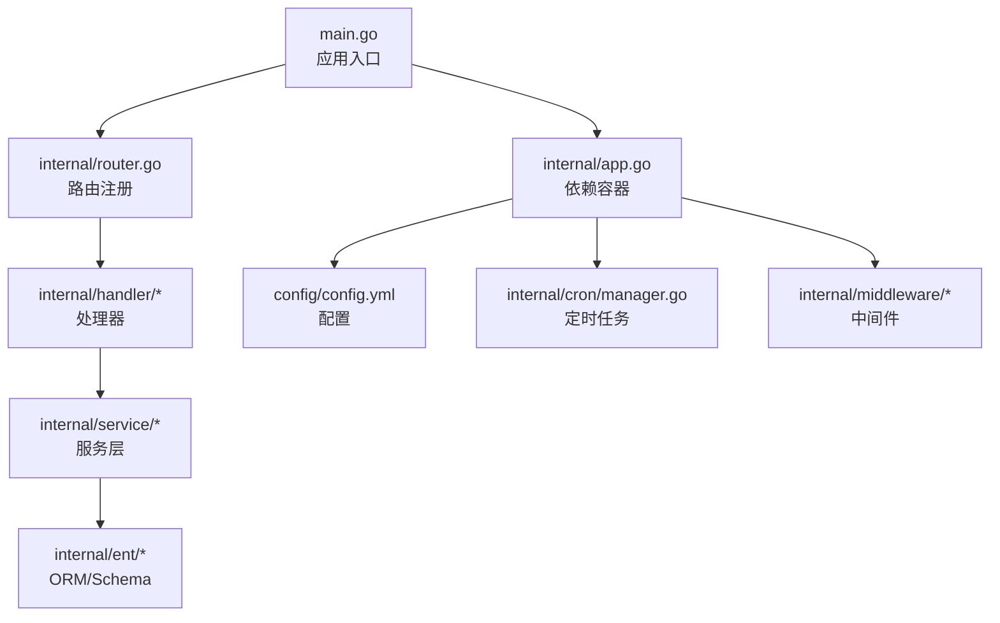
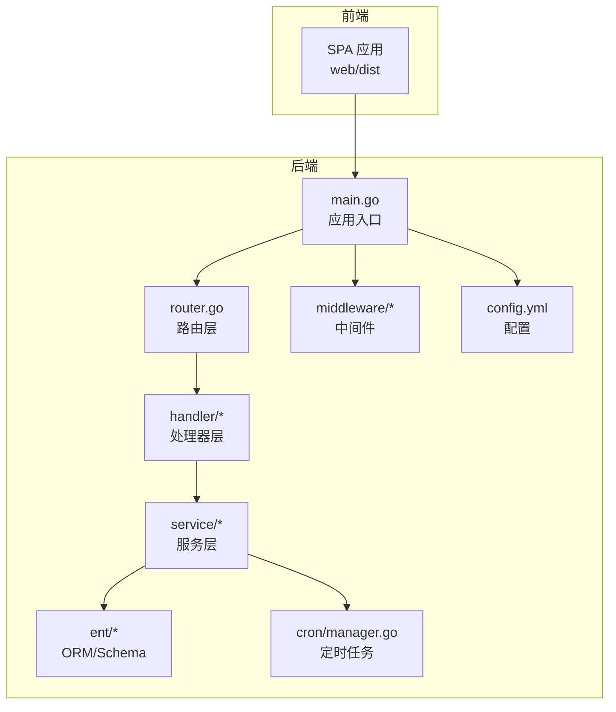
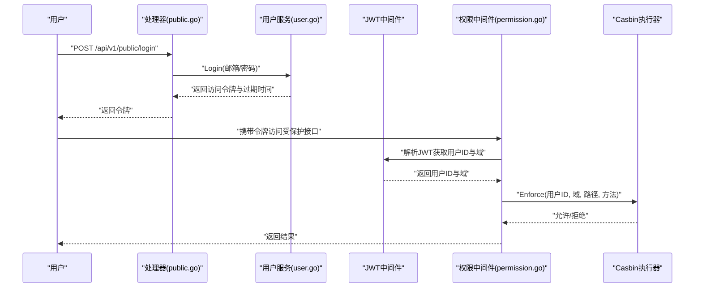
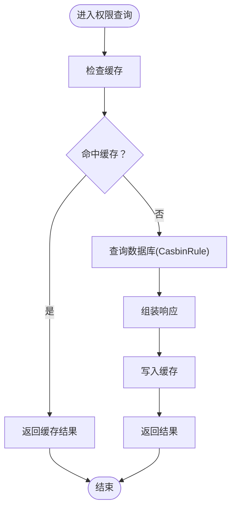
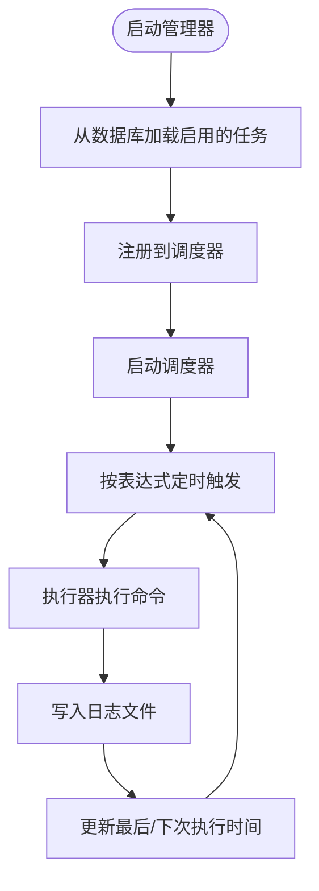
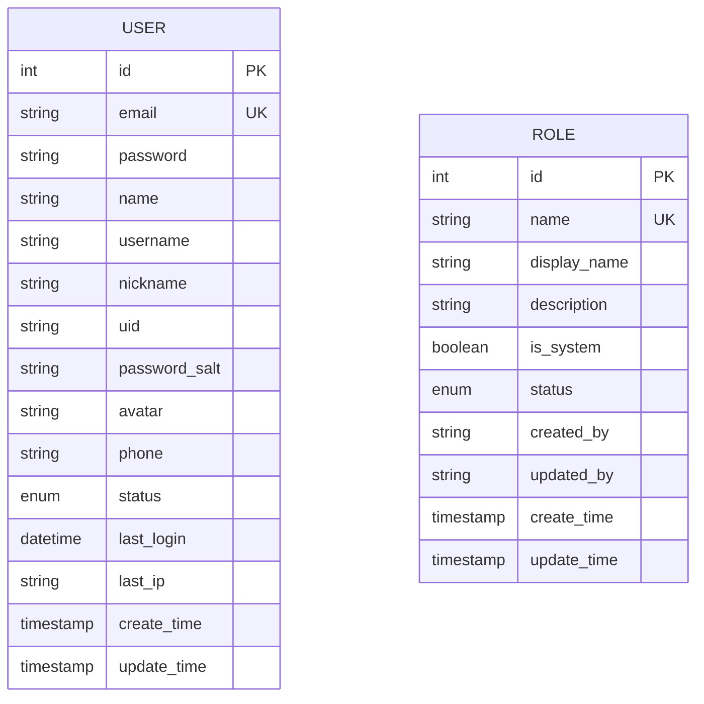
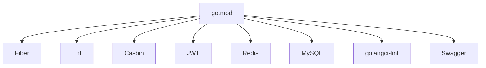

# 项目介绍

<cite>
**本文引用的文件**
- [main.go](file://main.go)
- [app.go](file://internal/app.go)
- [config.yml](file://config/config.yml)
- [router.go](file://internal/router.go)
- [user.go](file://internal/service/user.go)
- [permission.go](file://internal/service/permission.go)
- [role.go](file://internal/service/role.go)
- [manager.go](file://internal/cron/manager.go)
- [public.go](file://internal/handler/public.go)
- [user.go](file://internal/ent/schema/user.go)
- [role.go](file://internal/ent/schema/role.go)
- [permission.go](file://internal/middleware/permission.go)
- [go.mod](file://go.mod)
- [README.md](file://README.md)
</cite>

## 目录
1. [简介](#简介)
2. [项目结构](#项目结构)
3. [核心组件](#核心组件)
4. [架构总览](#架构总览)
5. [详细组件分析](#详细组件分析)
6. [依赖分析](#依赖分析)
7. [性能考虑](#性能考虑)
8. [故障排查指南](#故障排查指南)
9. [结论](#结论)
10. [附录](#附录)

## 简介
Go Admin 是一个基于 Go 语言构建的企业级后台管理系统，采用 Fiber Web 框架、Ent ORM 和自定义 CMF 基础框架，提供高性能、类型安全、可扩展的后台管理能力。系统覆盖用户管理、权限控制（基于 Casbin 的 RBAC）、文件系统、定时任务、动态配置、操作日志等核心模块，并内置 JWT 认证与加密、缓存与日志、前后端一体化部署等工程化能力。

- 核心价值主张
  - 统一后台管理：一套系统覆盖用户、权限、文件、任务、配置等常用后台能力，降低重复造轮子成本。
  - 权限控制精细化：基于 Casbin 的多域 RBAC 模型，支持 API、菜单、按钮三级权限粒度，满足复杂业务场景。
  - 文件管理便捷：支持本地与 S3 兼容对象存储，提供上传、移动、预览、批量删除等能力。
  - 定时任务可观测：内置任务调度器，支持 Shell、Curl、Task 三种执行器，提供日志轮转与执行统计。
  - 开发友好：清晰的分层架构、完善的中间件体系、Swagger 文档、一键构建与部署能力。

- 目标用户
  - 企业 IT 团队：快速搭建内部管理平台、审批流程、数据治理与运维工具。
  - 产品与运营团队：通过可视化界面与 API 管理用户、角色、权限与系统配置。
  - 开发者：基于模块化服务层与中间件扩展新功能，遵循统一的开发规范与测试标准。

- 应用场景
  - 内部管理系统（人事、资产、工单、公告）。
  - 多租户后台（通过多域权限模型隔离租户资源）。
  - 运维自动化（定时任务执行备份、巡检、通知等）。
  - 数据字典与动态配置中心（支持按组与键查询）。

- 设计理念
  - 分层架构：路由层、处理器层、服务层、数据访问层职责清晰，便于维护与扩展。
  - 中间件优先：统一认证、权限、日志、缓存等横切关注点，减少重复代码。
  - 类型安全：Ent ORM 保证数据库操作的类型安全与可维护性。
  - 可观测性：日志、缓存、任务日志、操作日志形成闭环，便于排障与审计。

- 解决的实际问题
  - 统一化：避免不同项目重复实现用户、权限、文件等模块。
  - 精细化：细粒度权限控制，支持菜单、按钮、API 三类权限，满足合规与安全要求。
  - 可靠性：任务日志轮转、JWT 安全、密码加密、SQL 注入防护等工程化措施。

- 开源协议与社区
  - 许可证：MIT 许可证，允许商用与二次开发。
  - 社区支持：提供 GitHub Issues 与 Discussions，欢迎提交 Issue、功能请求与 PR。
  - 文档生态：包含架构、数据库、部署、开发指南等完整文档。

- 未来路线图（基于现有模块与配置推演）
  - 权限模型增强：支持更复杂的权限组合与条件表达式。
  - 文件系统扩展：支持更多云存储驱动与直传优化。
  - 任务执行器扩展：新增更多执行器（如 HTTP、脚本语言）。
  - 监控与告警：集成指标采集与告警通道。
  - 多语言与国际化：支持多语言界面与文案管理。

- 版本信息与兼容性
  - Go 版本：1.25.1+
  - 数据库：MySQL 5.7+/8.0+（推荐 8.0+）
  - 缓存：Redis 5.0+（可选）
  - 前端：内嵌 SPA，通过文件系统中间件提供静态资源与 SPA 路由回退。

- 系统需求
  - CPU：单核即可满足中小规模业务。
  - 内存：建议 512MB+，根据并发与缓存策略调整。
  - 存储：日志与文件存储建议独立挂载盘，定期清理与备份。
  - 网络：开放监听端口（默认 9501），反向代理与 SSL 配置按需开启。

## 项目结构
项目采用分层架构与模块化组织，核心目录与职责如下：
- main.go：应用入口，初始化 Fiber 应用、嵌入前端静态资源、注册中间件与路由、启动生命周期钩子。
- internal：核心业务代码
  - app.go：应用依赖容器，聚合配置、日志、数据库、缓存、ORM、Casbin、文件系统等。
  - router.go：路由注册，按 /api/v1/admin 分组，区分公开接口与受保护接口，集成 JWT 与权限中间件。
  - service：业务服务层，封装用户、角色、权限、定时任务、文件、配置等业务逻辑。
  - handler：HTTP 处理器，负责请求解析、参数校验、调用服务层与响应封装。
  - middleware：中间件，如 JWT、权限、域解析等。
  - ent：Ent ORM 生成代码与 schema 定义。
  - cron：定时任务管理器与执行器。
  - global：全局变量与常量。
  - utils：通用工具与响应封装。
- config：应用配置，支持 YAML 管理数据库、缓存、Redis、文件系统、Casbin 等。
- data：运行时数据，包含日志与文件存储目录。
- docs：项目文档（Swagger、架构、数据库、部署、开发指南等）。

**图表来源**
- [main.go:47-107](file://main.go#L47-L107)
- [router.go:16-189](file://internal/router.go#L16-L189)
- [app.go:15-25](file://internal/app.go#L15-L25)
- [config.yml:1-143](file://config/config.yml#L1-L143)
- [manager.go:17-77](file://internal/cron/manager.go#L17-L77)

**章节来源**
- [README.md:40-69](file://README.md#L40-L69)
- [main.go:47-107](file://main.go#L47-L107)
- [router.go:16-189](file://internal/router.go#L16-L189)
- [app.go:15-25](file://internal/app.go#L15-L25)
- [config.yml:1-143](file://config/config.yml#L1-L143)

## 核心组件
- 应用入口与中间件
  - 嵌入前端静态资源，通过文件系统中间件提供 SPA 路由回退。
  - 注册请求日志中间件、JWT 中间件、权限中间件、域中间件。
- 路由与控制器
  - 公开接口：登录、刷新令牌、获取 RSA 公钥。
  - 受保护接口：用户信息、修改密码、角色管理、权限管理、定时任务、文件管理、操作日志、数据字典、动态配置等。
- 服务层
  - 用户服务：登录、刷新令牌、更新信息、修改密码。
  - 权限服务：权限 CRUD、角色权限分配、用户权限查询、权限校验。
  - 角色服务：角色 CRUD、启用/禁用、与用户权限缓存联动。
  - 定时任务：任务注册、立即执行、日志轮转、下次执行时间更新。
- ORM 与数据模型
  - 用户、角色、权限规则、定时任务、字典、系统配置等模型。
- 中间件
  - JWT 解析与域解析、权限校验、请求日志记录。

**章节来源**
- [public.go:27-145](file://internal/handler/public.go#L27-L145)
- [router.go:16-189](file://internal/router.go#L16-L189)
- [user.go:139-218](file://internal/service/user.go#L139-L218)
- [permission.go:190-335](file://internal/service/permission.go#L190-L335)
- [role.go:118-336](file://internal/service/role.go#L118-L336)
- [manager.go:40-116](file://internal/cron/manager.go#L40-L116)
- [user.go:17-102](file://internal/ent/schema/user.go#L17-L102)
- [role.go:10-73](file://internal/ent/schema/role.go#L10-L73)
- [permission.go:11-80](file://internal/middleware/permission.go#L11-L80)

## 架构总览
系统采用分层架构，前后端一体化部署，核心组件通过依赖容器统一管理。

**图表来源**
- [main.go:47-107](file://main.go#L47-L107)
- [router.go:16-189](file://internal/router.go#L16-L189)
- [manager.go:17-77](file://internal/cron/manager.go#L17-L77)
- [config.yml:1-143](file://config/config.yml#L1-L143)

## 详细组件分析

### 用户与认证流程
用户登录与权限校验的关键流程如下：

**图表来源**
- [public.go:78-145](file://internal/handler/public.go#L78-L145)
- [user.go:139-218](file://internal/service/user.go#L139-L218)
- [permission.go:11-80](file://internal/middleware/permission.go#L11-L80)

**章节来源**
- [public.go:27-145](file://internal/handler/public.go#L27-L145)
- [user.go:139-218](file://internal/service/user.go#L139-L218)
- [permission.go:11-80](file://internal/middleware/permission.go#L11-L80)

### 权限服务与缓存策略
权限服务通过 Casbin 实现 RBAC 权限模型，并结合缓存提升查询性能。

**图表来源**
- [permission.go:514-557](file://internal/service/permission.go#L514-L557)
- [permission.go:560-753](file://internal/service/permission.go#L560-L753)

**章节来源**
- [permission.go:119-135](file://internal/service/permission.go#L119-L135)
- [permission.go:514-557](file://internal/service/permission.go#L514-L557)
- [permission.go:560-753](file://internal/service/permission.go#L560-L753)

### 定时任务管理器
定时任务管理器支持多种执行器与日志轮转，提供任务注册、立即执行与下次执行时间更新。

**图表来源**
- [manager.go:26-77](file://internal/cron/manager.go#L26-L77)
- [manager.go:154-221](file://internal/cron/manager.go#L154-L221)

**章节来源**
- [manager.go:17-77](file://internal/cron/manager.go#L17-L77)
- [manager.go:154-221](file://internal/cron/manager.go#L154-L221)

### 数据模型（用户与角色）
用户与角色的数据模型定义如下：

**图表来源**
- [user.go:17-102](file://internal/ent/schema/user.go#L17-L102)
- [role.go:10-73](file://internal/ent/schema/role.go#L10-L73)

**章节来源**
- [user.go:17-102](file://internal/ent/schema/user.go#L17-L102)
- [role.go:10-73](file://internal/ent/schema/role.go#L10-L73)

## 依赖分析
- 运行时依赖
  - Fiber：高性能 Web 框架。
  - Ent：类型安全 ORM。
  - Casbin：RBAC 权限控制。
  - JWT：令牌认证。
  - Redis：可选缓存。
  - MySQL：主数据库。
- 开发与测试
  - Go Modules：依赖管理。
  - golangci-lint：代码质量检查。
  - Swagger：API 文档生成。

**图表来源**
- [go.mod:5-19](file://go.mod#L5-L19)

**章节来源**
- [go.mod:1-128](file://go.mod#L1-L128)
- [README.md:18-39](file://README.md#L18-L39)

## 性能考虑
- 中间件链路：JWT 与权限中间件在受保护接口上逐个执行，建议合理设置缓存与日志级别，避免高并发下的瓶颈。
- 缓存策略：权限服务对角色与用户权限进行缓存，建议结合 Redis 提升横向扩展能力。
- 数据库连接：使用 Ent ORM 与连接池配置，建议根据并发与查询复杂度调整连接数与超时。
- 文件系统：本地与 S3 存储在服务层注入，建议对大文件上传增加分片与断点续传策略。
- 定时任务：日志轮转与下次执行时间更新在任务执行后异步完成，注意磁盘空间与 IO 压力。

## 故障排查指南
- 认证失败
  - 检查 JWT 密钥与过期时间配置。
  - 确认登录请求体参数与加密字段（如使用等保加密）。
- 权限不足
  - 确认用户所属角色与权限规则是否正确。
  - 检查域配置与中间件是否正确解析域信息。
- 数据库连接
  - 核对数据库连接信息与表前缀。
  - 检查表前缀与实际表名一致性。
- 缓存异常
  - 若使用 Redis，确认连接参数与网络连通性。
- 文件上传失败
  - 检查存储根目录权限与磁盘空间。
- 定时任务未执行
  - 检查任务表达式与调度器状态。
  - 查看任务日志文件与下次执行时间更新。

**章节来源**
- [config.yml:19-76](file://config/config.yml#L19-L76)
- [permission.go:11-80](file://internal/middleware/permission.go#L11-L80)
- [manager.go:40-77](file://internal/cron/manager.go#L40-L77)

## 结论
Go Admin 以 Fiber 与 Ent 为基础，结合 Casbin 权限模型与 JWT 认证，为企业级后台管理提供了高性能、可扩展、易维护的解决方案。通过清晰的分层架构与中间件体系，系统能够快速适配用户、权限、文件、任务、配置等常见后台需求，并提供完善的开发与运维工具链。建议在生产环境中启用 Redis 缓存、完善日志与监控、按需扩展任务执行器与文件存储能力，持续迭代以满足业务增长与合规要求。

## 附录
- 快速开始
  - 环境要求：Go 1.25.1+、MySQL 5.7+/8.0+、Redis 5.0+（可选）。
  - 安装与运行：下载依赖、准备数据库、编辑配置、构建并运行。
- API 文档
  - 公开接口：登录、刷新令牌、获取公钥。
  - 受保护接口：用户信息、修改密码、角色与权限管理、定时任务、文件管理、操作日志、数据字典、动态配置。
- 部署与监控
  - 支持 systemd 与 Docker 部署，提供健康检查与日志查看命令。
- 许可证与支持
  - MIT 许可证，欢迎通过 Issues 与 Discussions 参与社区建设。

**章节来源**
- [README.md:71-125](file://README.md#L71-L125)
- [README.md:126-188](file://README.md#L126-L188)
- [README.md:358-388](file://README.md#L358-L388)
- [README.md:449-451](file://README.md#L449-L451)