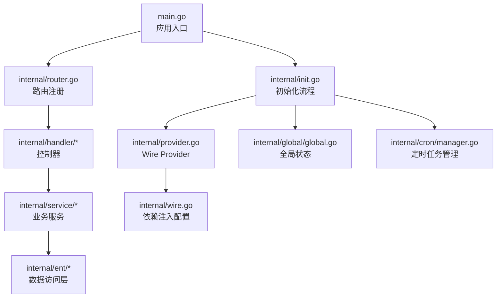
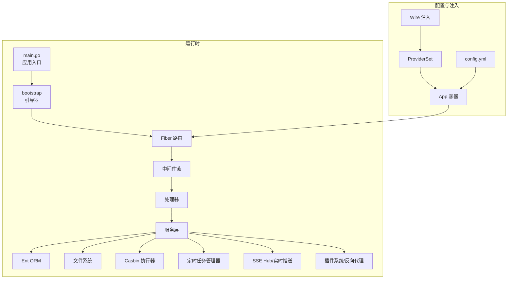
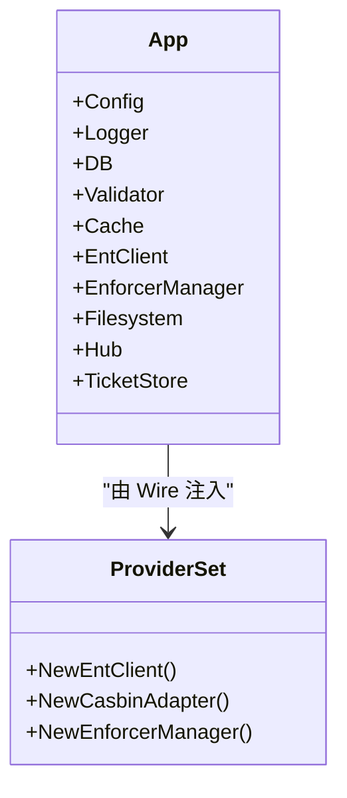
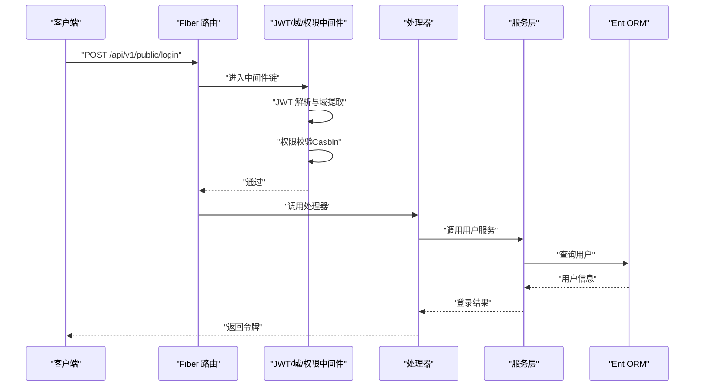
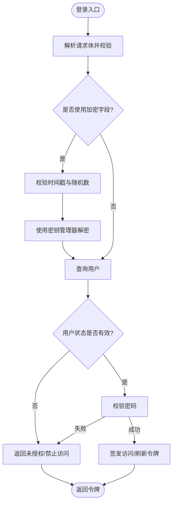
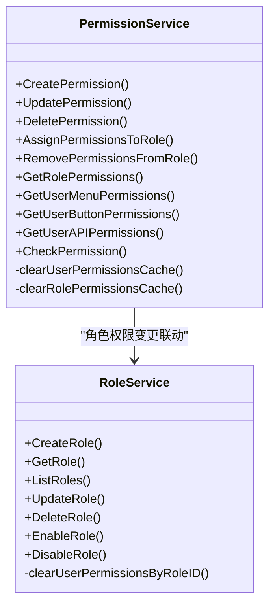
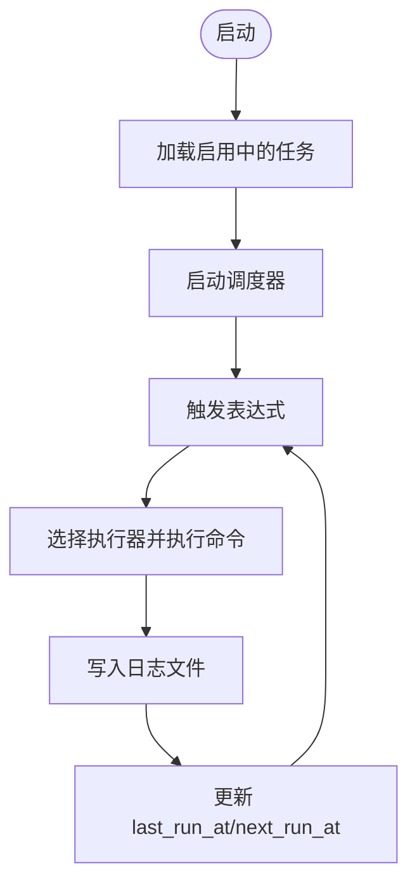
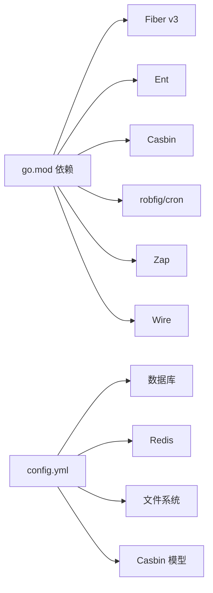

# 项目概述

<cite>
**本文引用的文件**
- [main.go](file://main.go)
- [app.go](file://internal/app.go)
- [config.yml](file://config/config.yml)
- [go.mod](file://go.mod)
- [init.go](file://internal/init.go)
- [router.go](file://internal/router.go)
- [provider.go](file://internal/provider.go)
- [wire.go](file://internal/wire.go)
- [global.go](file://internal/global/global.go)
- [manager.go](file://internal/cron/manager.go)
- [user.go](file://internal/service/user.go)
- [permission.go](file://internal/service/permission.go)
- [role.go](file://internal/service/role.go)
- [permission.go](file://internal/middleware/permission.go)
- [public.go](file://internal/handler/public.go)
- [message.go](file://internal/handler/message.go)
- [sse.go](file://internal/handler/sse.go)
- [plugin.go](file://internal/handler/plugin.go)
- [plugin.go](file://internal/service/plugin.go)
- [manager.go](file://internal/plugin/manager.go)
</cite>

## 目录
1. [简介](#简介)
2. [项目结构](#项目结构)
3. [核心组件](#核心组件)
4. [架构总览](#架构总览)
5. [详细组件分析](#详细组件分析)
6. [依赖关系分析](#依赖关系分析)
7. [性能考虑](#性能考虑)
8. [故障排查指南](#故障排查指南)
9. [结论](#结论)
10. [附录](#附录)

## 简介
Go Admin 是一款面向企业级场景的现代化管理系统，围绕高性能 Web 服务与高可靠数据持久化构建。系统采用 Fiber v3 框架作为 Web 层，结合 Ent ORM 实现强类型的数据库访问；权限体系基于 Casbin 提供细粒度的多域 RBAC 控制；定时任务模块支持多种执行器与日志归档；文件系统抽象支持本地与 S3 等多种存储后端；站内消息与 SSE 实时推送提供即时通信能力；插件系统支持动态安装、启用、禁用和卸载第三方扩展；配置中心与缓存层提供灵活的运行时能力。

系统定位清晰：既可作为企业后台的统一入口，也可作为微服务治理下的权限与配置中枢。典型应用场景包括：
- 用户与角色管理：集中维护用户、角色、权限映射
- 权限控制：基于路径与方法的 API 精准授权
- 文件系统：统一的附件上传、分组与预览
- 定时任务：Shell/Curl/Task 等多种任务类型，支持日志滚动与保留
- 站内消息与推送：按用户/角色/全员广播消息，通过 SSE 实时推送
- 插件系统：动态安装、启停第三方扩展，支持 UDS/进程通信
- 动态配置：按组与键值管理运行时配置
- 操作审计：记录关键业务操作日志

## 项目结构
项目采用“分层 + 模块化”的组织方式：
- 根目录包含入口程序、配置与文档
- internal 内部模块按职责拆分：应用容器、初始化流程、路由与中间件、服务层、处理器层、定时任务、工具与全局状态
- ent 目录为 Ent ORM 自动生成的实体与查询代码
- config 目录存放运行配置

图表来源
- [main.go:47-107](file://main.go#L47-L107)
- [router.go:16-189](file://internal/router.go#L16-L189)
- [init.go:39-96](file://internal/init.go#L39-L96)
- [provider.go:17-46](file://internal/provider.go#L17-L46)
- [wire.go:22-37](file://internal/wire.go#L22-L37)
- [global.go:11-16](file://internal/global/global.go#L11-L16)
- [manager.go:26-77](file://internal/cron/manager.go#L26-L77)

章节来源
- [main.go:47-107](file://main.go#L47-L107)
- [router.go:16-189](file://internal/router.go#L16-L189)
- [init.go:39-96](file://internal/init.go#L39-L96)
- [provider.go:17-46](file://internal/provider.go#L17-L46)
- [wire.go:22-37](file://internal/wire.go#L22-L37)
- [global.go:11-16](file://internal/global/global.go#L11-L16)
- [manager.go:26-77](file://internal/cron/manager.go#L26-L77)

## 核心组件
- 应用容器 App：聚合配置、日志、数据库、校验器、缓存、Ent 客户端、Casbin 执行器、文件系统、SSE Hub、TicketStore 等依赖
- 初始化流程 Init：负责数据库与 Casbin 的初始化、定时任务启动、密钥与随机数存储初始化、SSE Hub 初始化、分片上传清理协程启动、种子数据与字典数据写入
- 路由与中间件：基于 Fiber v3 的路由分组与中间件链，包含 JWT 认证、权限校验、域解析、黑名单校验等
- 服务层：用户、角色、权限、定时任务、附件、配置、字典、站内消息与偏好、消息广播、插件管理等业务服务
- 处理器层：HTTP 接口实现，负责请求解析、参数校验、调用服务与响应封装
- 定时任务：基于 robfig/cron 的调度器，支持 Shell/Curl/Task 三种执行器与日志归档
- 站内消息与 SSE：支持按用户/角色/全员广播，通过 SSE 实时推送，含消息偏好与免打扰设置
- 插件系统：支持插件安装、启用、禁用、卸载，通过 UDS/HTTP 反向代理访问插件端点
- 配置与缓存：YAML 配置驱动，支持内存与 Redis 缓存

章节来源
- [app.go:15-28](file://internal/app.go#L15-L28)
- [init.go:39-96](file://internal/init.go#L39-L96)
- [router.go:16-365](file://internal/router.go#L16-L365)
- [permission.go:119-135](file://internal/service/permission.go#L119-L135)
- [role.go:41-56](file://internal/service/role.go#L41-L56)
- [user.go:37-45](file://internal/service/user.go#L37-L45)
- [manager.go:17-38](file://internal/cron/manager.go#L17-L38)
- [config.yml:1-143](file://config/config.yml#L1-L143)

## 架构总览
系统采用“入口程序 → 引导器 → 路由 → 中间件 → 处理器 → 服务 → 数据库/外部系统”的标准分层架构。Wire 负责依赖注入，全局状态承载 ORM、Casbin、定时任务等共享对象。

图表来源
- [main.go:47-107](file://main.go#L47-L107)
- [router.go:16-365](file://internal/router.go#L16-L365)
- [provider.go:17-46](file://internal/provider.go#L17-L46)
- [wire.go:22-37](file://internal/wire.go#L22-L37)
- [app.go:15-28](file://internal/app.go#L15-L28)
- [config.yml:1-143](file://config/config.yml#L1-L143)

## 详细组件分析

### 应用容器与依赖注入
- App 容器聚合了系统所需的关键依赖，便于在各层之间传递
- Wire 通过 ProviderSet 与自定义 Provider 动态创建 Ent 客户端、Casbin 适配器与执行器管理器，并完成数据库迁移
- 初始化流程根据是否注入了 App 实例选择走 Wire 或手动初始化路径

图表来源
- [app.go:15-28](file://internal/app.go#L15-L28)
- [provider.go:17-46](file://internal/provider.go#L17-L46)
- [wire.go:22-37](file://internal/wire.go#L22-L37)

章节来源
- [app.go:15-28](file://internal/app.go#L15-L28)
- [provider.go:17-46](file://internal/provider.go#L17-L46)
- [wire.go:22-37](file://internal/wire.go#L22-L37)
- [init.go:39-96](file://internal/init.go#L39-L96)

### 路由与中间件
- 路由分组清晰：公开接口（登录、刷新、公钥）、管理员认证接口、权限接口（角色、权限、用户权限）、定时任务、附件、操作日志、字典、动态配置、站内消息、SSE 凭证签发、插件管理、插件反向代理
- 中间件链：请求日志、JWT 认证、域解析、黑名单校验、权限校验
- 权限校验通过 Casbin 执行器对用户 UID、域、路径与方法进行匹配

图表来源
- [router.go:16-365](file://internal/router.go#L16-L365)
- [permission.go:11-80](file://internal/middleware/permission.go#L11-L80)
- [public.go:78-145](file://internal/handler/public.go#L78-L145)
- [user.go:139-200](file://internal/service/user.go#L139-L200)

章节来源
- [router.go:16-365](file://internal/router.go#L16-L365)
- [permission.go:11-80](file://internal/middleware/permission.go#L11-L80)
- [public.go:78-145](file://internal/handler/public.go#L78-L145)
- [user.go:139-200](file://internal/service/user.go#L139-L200)

### 用户与认证
- 用户服务提供注册、登录、刷新令牌、修改密码、获取用户信息等能力
- 登录支持明文与加密字段组合，结合时间戳与随机数防重放攻击
- 令牌包含域信息，便于多域权限隔离

图表来源
- [public.go:78-145](file://internal/handler/public.go#L78-L145)
- [user.go:139-200](file://internal/service/user.go#L139-L200)

章节来源
- [public.go:78-145](file://internal/handler/public.go#L78-L145)
- [user.go:139-200](file://internal/service/user.go#L139-L200)

### 权限与角色
- 权限类型分为 API、菜单、按钮三类，支持对角色批量分配/移除权限
- 用户权限查询支持菜单、按钮、API 三种维度
- 权限缓存通过 TypedCache 降低查询成本，变更时自动清理相关缓存

图表来源
- [permission.go:96-135](file://internal/service/permission.go#L96-L135)
- [role.go:27-56](file://internal/service/role.go#L27-L56)

章节来源
- [permission.go:96-135](file://internal/service/permission.go#L96-L135)
- [role.go:27-56](file://internal/service/role.go#L27-L56)

### 定时任务
- CronManager 基于 robfig/cron，支持 Shell、Curl、Task 三种执行器
- 支持立即执行、启用/禁用、日志查看与滚动清理
- 任务执行过程记录开始/结束时间、耗时与结果，并更新下次执行时间

图表来源
- [manager.go:40-77](file://internal/cron/manager.go#L40-L77)
- [manager.go:154-221](file://internal/cron/manager.go#L154-L221)

章节来源
- [manager.go:17-38](file://internal/cron/manager.go#L17-L38)
- [manager.go:40-77](file://internal/cron/manager.go#L40-L77)
- [manager.go:154-221](file://internal/cron/manager.go#L154-L221)

### 文件系统与附件
- 通过文件系统抽象支持本地与 S3 等存储后端
- 附件分组与附件管理提供上传、移动、预览、批量删除等能力
- 与处理器层配合，实现前端静态资源与 API 的统一托管

章节来源
- [config.yml:60-76](file://config/config.yml#L60-L76)
- [router.go:130-152](file://internal/router.go#L130-L152)

### 配置与字典
- 动态配置支持按组与键值查询，便于运行时调整策略
- 字典模块为操作日志等模块提供枚举型配置，如“认证”、“用户”、“角色”等

章节来源
- [router.go:256-270](file://internal/router.go#L256-L270)
- [init.go:312-371](file://internal/init.go#L312-L371)

### 站内消息与 SSE 实时推送
- 站内消息支持 system/business/task 三种类型，info/warning/error 三种级别
- 消息服务集成 SSE Hub，创建消息时同步触发实时推送
- 用户消息偏好支持桌面通知开关、消息类型订阅、免打扰时间段设置
- 消息广播支持按全员、指定用户集合、角色解析目标三种模式
- SSE 连接通过 ticket 独立鉴权，支持断线重连后补发遗漏消息

章节来源
- [router.go:336-364](file://internal/router.go#L336-L364)
- [handler/sse.go:1-30](file://internal/handler/sse.go#L1-L30)
- [service/message_service.go:1-50](file://internal/service/message_service.go#L1-L50)
- [service/message_preference_service.go:1-30](file://internal/service/message_preference_service.go#L1-L30)
- [service/message_broadcast_service.go:1-30](file://internal/service/message_broadcast_service.go#L1-L30)

### 插件系统
- 插件系统支持插件的安装、启用、禁用、卸载生命周期管理
- 插件通过 UDS（Unix Domain Socket）或 HTTP 方式暴露端点
- 插件反向代理路由位于 `/api/v1/plugin/:plugin_id/*`，支持鉴权与权限校验
- 插件的安装包通过上传 ZIP 文件完成，解压后注册到扩展注册表
- 插件运行时按进程隔离，通过 CMF PluginRuntime 管理
- `Plugin` 数据实体记录: plugin_id、名称、版本、作者、描述、状态(installed/enabled/disabled/error)

章节来源
- [router.go:88-124](file://internal/router.go#L88-L124)
- [handler/plugin.go:1-50](file://internal/handler/plugin.go#L1-L50)
- [service/plugin.go:1-50](file://internal/service/plugin.go#L1-L50)
- [plugin/manager.go:1-50](file://internal/plugin/manager.go#L1-L50)

## 依赖关系分析
- 运行时依赖：Fiber v3、Ent、Casbin v2.135.0、robfig/cron、Zap v1.28.0、JWT v5.3.1、Wire 注入、CMF 基础设施库
- 配置驱动：YAML 驱动数据库、缓存、Redis、文件系统、Casbin 多域模型
- 初始化顺序：配置 → 数据库与 Schema 迁移 → Casbin 执行器 → 定时任务 → Nonce 存储 → 密钥管理 → SSE Hub → 分片上传清理 → 种子数据 → 字典数据

图表来源
- [go.mod:5-19](file://go.mod#L5-L19)
- [config.yml:19-76](file://config/config.yml#L19-L76)

章节来源
- [go.mod:5-19](file://go.mod#L5-L19)
- [config.yml:19-76](file://config/config.yml#L19-L76)
- [init.go:98-132](file://internal/init.go#L98-L132)

## 性能考虑
- 路由与中间件链短而精，减少不必要的处理开销
- 权限查询引入缓存，降低 Casbin 查询压力
- 定时任务执行日志异步落盘，避免阻塞调度器
- 数据库迁移采用索引/列清理策略，保证演进过程的稳定性
- 文件系统支持多后端，可根据部署环境选择最优存储
- SSE 连接使用 ticket 独立鉴权，避免与业务请求争抢连接池
- 插件进程隔离运行，避免插件异常影响主服务稳定

## 故障排查指南
- 登录失败
  - 检查用户状态是否有效
  - 核对密码哈希与盐值
  - 若使用加密登录，确认时间戳与随机数未过期且未重复使用
- 权限拒绝
  - 确认 JWT 中域信息正确
  - 检查 Casbin 策略与分组规则是否生效
  - 如有缓存，尝试清理相关缓存键
- 定时任务异常
  - 查看任务日志文件，确认命令可执行
  - 检查任务表达式与执行器类型
  - 确认日志目录权限与磁盘空间
- 数据库迁移失败
  - 检查表前缀与连接配置
  - 确认迁移选项（索引/列清理）符合预期
- SSE 连接异常
  - 确认 ticket 未过期，重新签发
  - 检查 Hub 是否正常启动，确认消息推送通道正常

章节来源
- [public.go:132-142](file://internal/handler/public.go#L132-L142)
- [permission.go:49-63](file://internal/middleware/permission.go#L49-L63)
- [manager.go:154-221](file://internal/cron/manager.go#L154-L221)
- [provider.go:30-36](file://internal/provider.go#L30-L36)

## 结论
Go Admin 以 Fiber v3 的高性能与 Ent 的强类型能力为基础，结合 Casbin 的细粒度权限模型与 robust 的定时任务机制，并集成站内消息、SSE 实时推送、插件系统等扩展能力，为企业级管理提供了稳定、可扩展、易运维的解决方案。通过模块化设计与依赖注入，系统具备良好的可测试性与可演进性；通过配置驱动与缓存优化，兼顾灵活性与性能表现。

## 附录
- 快速理解路径（初学者）
  - 从 main.go 了解应用启动流程
  - 在 router.go 中识别公开/认证/权限接口分组
  - 在 handler 层查看登录与用户信息接口
  - 在 service 层理解用户、角色、权限的业务逻辑
  - 在 init.go 了解初始化顺序与种子数据
- 技术深度（专家）
  - Wire Provider 与自定义 Provider 的注入策略
  - Ent Schema 迁移与表前缀初始化
  - Casbin 多域模型与策略加载
  - 站内消息与 SSE 实时推送架构
  - 插件系统生命周期与反向代理机制
  - 定时任务执行器扩展与日志归档策略
  - 文件系统抽象与 S3 集成