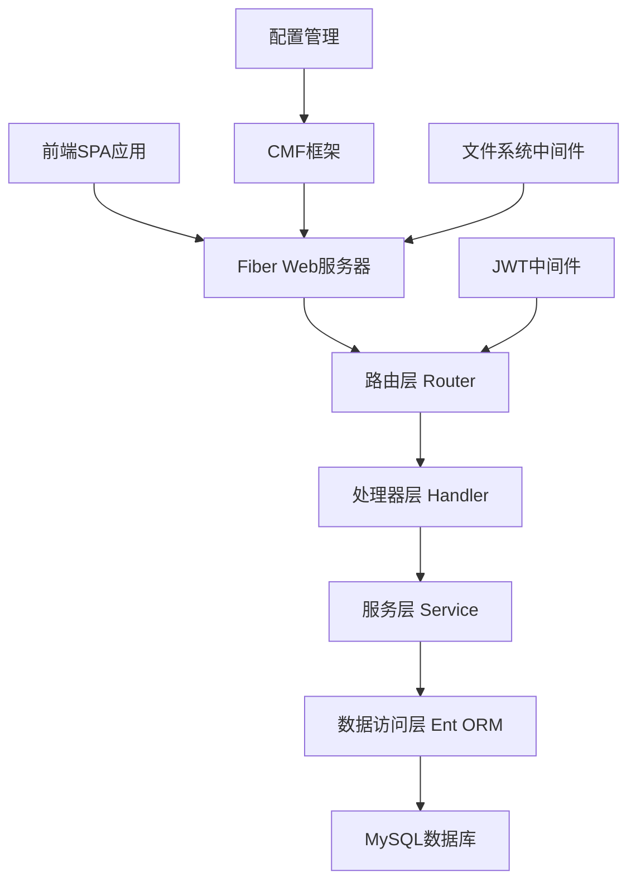

# 架构概览文档

## 系统架构

go-admin是一个基于Go语言的现代化管理后台API系统，采用分层架构设计，具有良好的可扩展性和维护性。

### 整体架构图



## 核心组件

### 1. 应用入口层 (main.go)

**职责**: 应用程序启动和初始化

**核心功能**:
- 使用CMF框架的Bootstrap模式启动应用
- 注册初始化函数、中间件、路由和清理函数
- 嵌入前端静态资源 (web/dist)
- 处理SPA路由回退

**关键代码结构**:
```go
bootstrap := bootstrap.NewBootstrap()
bootstrap.RegisterInitFunc(internal.Init)
bootstrap.RegisterMiddleware(...)
bootstrap.RegisterRoute(internal.RegisterRoute)
bootstrap.RegisterCleanupFunc(internal.Cleanup)
```

### 2. 初始化层 (internal/init.go)

**职责**: 系统组件初始化

**核心功能**:
- 数据库连接初始化
- Ent ORM客户端创建
- 数据库Schema自动迁移
- 全局变量设置

**依赖关系**:
- 依赖CMF框架的配置管理
- 依赖Ent ORM框架
- 设置global包中的全局变量

### 3. 路由层 (internal/router.go)

**职责**: HTTP路由定义和管理

**路由结构**:
```
/api
└── /v1
    ├── /public             (公开接口)
    │   └── POST /login
    └── /admin
        └── /auth           (需要JWT认证)
            ├── GET /user
            ├── PUT /user
            └── PUT /password
```

**中间件**:
- 版本标识中间件 (为v1路由添加Version头)
- JWT认证中间件 (保护/auth路由组)

### 4. 处理器层 (internal/handler/)

**职责**: HTTP请求处理和响应

**当前处理器**:
- `Login`: 用户登录处理 (公开接口)
- `GetUser`: 获取用户信息 (需要认证)
- `UpdateUser`: 更新用户信息 (需要认证)
- `ChangePassword`: 修改密码 (需要认证)

**设计特点**:
- 使用Fiber框架的Context和Locals
- 统一的响应格式处理
- 完整的错误处理机制
- JWT认证集成

### 5. 服务层 (internal/service/)

**职责**: 业务逻辑处理

**当前服务**:
- `UserService`: 用户相关业务逻辑
  - `Login()`: 用户登录逻辑
  - `Register()`: 用户注册逻辑
  - `GetUserByID()`: 根据ID获取用户
  - `UpdateUser()`: 更新用户信息
  - `ChangePassword()`: 修改密码

**设计模式**:
- 采用接口和实现分离模式
- 提供工厂函数 `NewUserService()`
- 完整的错误类型定义
- 业务逻辑与数据访问分离

### 6. 数据访问层 (internal/ent/)

**职责**: 数据库操作和ORM管理

**核心组件**:
- Ent ORM生成的客户端代码
- Schema定义 (User, CasbinRule)
- 自动生成的CRUD操作

**特点**:
- 类型安全的数据库操作
- 自动代码生成
- 支持复杂查询和关系

### 7. 全局状态管理 (internal/global/)

**职责**: 全局变量和状态管理

**全局变量**:
- `ORM`: Ent数据库客户端实例
- `Bootstrap`: CMF框架启动器实例

**全局常量**:
- `ResponseMsg`: 响应消息映射
- 响应状态码常量 (200, 400, 401, 403, 404, 500等)

**设计原则**:
- 最小化全局状态
- 线程安全访问
- 统一的资源管理
- 标准化的响应格式

### 8. 资源清理 (internal/cleanup.go)

**职责**: 应用关闭时的资源清理

**清理内容**:
- 数据库连接关闭
- 全局变量重置
- 防止资源泄露

## 技术栈

### 核心框架
- **Web框架**: Fiber v2.52.9 - 高性能HTTP框架
- **ORM框架**: Ent v0.14.5 - 类型安全的ORM
- **自定义框架**: CMF v1.0.0 - 项目特定的基础框架

### 中间件和工具
- **认证**: JWT中间件
- **文件服务**: Fiber文件系统中间件
- **数据库驱动**: MySQL驱动
- **配置管理**: YAML配置文件

### 开发工具
- **Go版本**: 1.25.1
- **构建工具**: Go Modules
- **代码生成**: Ent代码生成器
- **代码质量**: golangci-lint静态分析工具

## 设计模式

### 1. 分层架构模式
- **表现层**: Handler处理HTTP请求
- **业务层**: Service处理业务逻辑
- **数据层**: Ent ORM处理数据访问

### 2. 依赖注入模式
- 通过CMF框架的Bootstrap模式注入依赖
- 配置对象在各层间传递
- 全局状态最小化

### 3. 中间件模式
- JWT认证中间件
- 版本控制中间件
- 文件服务中间件

### 4. 工厂模式
- `NewUserService()` 创建服务实例
- `bootstrap.NewBootstrap()` 创建启动器

## 数据流

### 请求处理流程
1. **HTTP请求** → Fiber Web服务器
2. **路由匹配** → Router层分发请求
3. **中间件处理** → JWT验证、版本控制等
4. **Handler处理** → 解析请求参数
5. **Service调用** → 执行业务逻辑
6. **数据访问** → 通过Ent ORM操作数据库
7. **响应返回** → 构造HTTP响应

### 数据库操作流程
1. **全局ORM客户端** → 统一的数据库访问入口
2. **Schema定义** → Ent Schema文件定义数据模型
3. **代码生成** → 自动生成类型安全的操作代码
4. **事务管理** → Ent提供的事务支持

## 配置管理

### 配置文件结构
- **应用配置**: 端口、调试模式、密钥等
- **数据库配置**: 连接信息、表前缀等
- **缓存配置**: Redis和内存缓存
- **日志配置**: 文件输出和控制台输出
- **存储配置**: 本地存储和S3配置

### 配置加载流程
1. CMF框架加载 `config/config.yml`
2. 配置对象在各组件间传递
3. 运行时配置热更新支持

## 安全特性

### 认证和授权
- **JWT认证**: 保护需要认证的API端点
- **Casbin权限控制**: 基于RBAC的权限管理
- **密码安全**: 密码字段标记为敏感数据

### 数据安全
- **敏感字段保护**: password、password_salt等字段
- **SQL注入防护**: Ent ORM提供的类型安全查询
- **配置安全**: 敏感配置信息的保护

## 扩展性设计

### 水平扩展
- 无状态设计，支持多实例部署
- 数据库连接池管理
- 缓存层支持分布式缓存

### 功能扩展
- 模块化的Handler和Service设计
- 插件式的中间件架构
- 灵活的路由组织结构

### 维护性
- 清晰的分层架构
- 统一的错误处理
- 完善的日志记录

## 性能优化

### 数据库优化
- Ent ORM的查询优化
- 数据库索引设计
- 连接池管理

### 缓存策略
- 多级缓存支持 (内存+Redis)
- 缓存过期策略
- 缓存穿透保护

### 静态资源
- 嵌入式静态资源
- SPA路由优化
- 文件系统中间件

## 监控和运维

### 日志管理
- 结构化日志输出
- 文件和控制台双输出
- 日志轮转和归档

### 健康检查
- 数据库连接状态
- 应用启动状态
- 资源使用监控

### 部署支持
- Docker容器化支持
- 配置文件外部化
- 优雅关闭机制